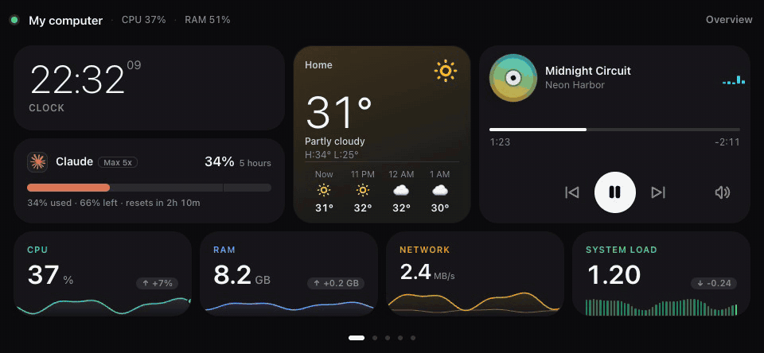
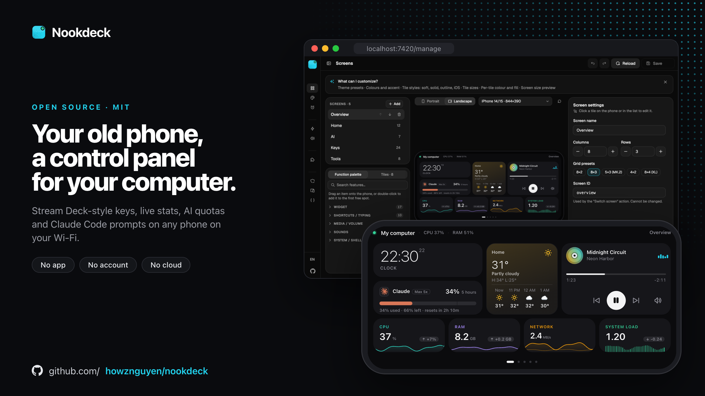
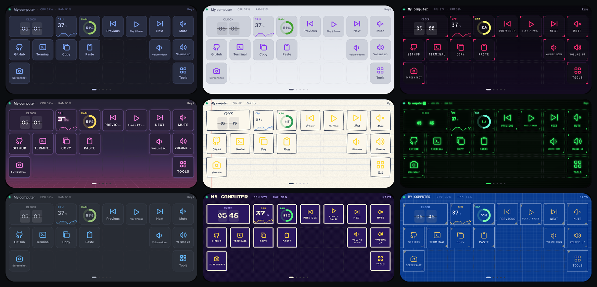
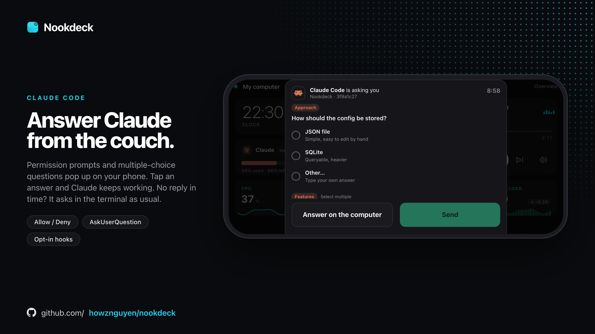
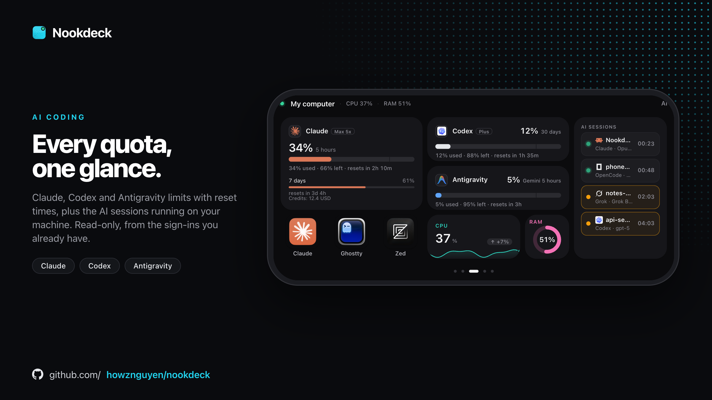
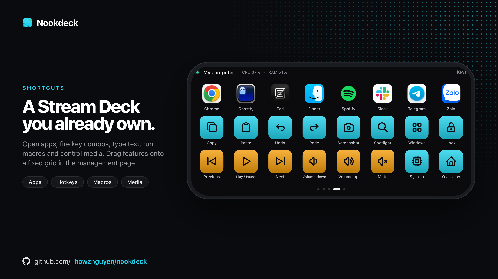
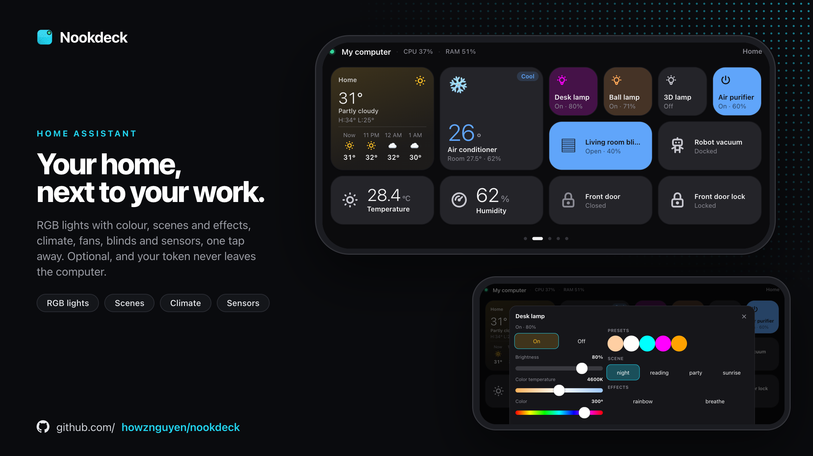
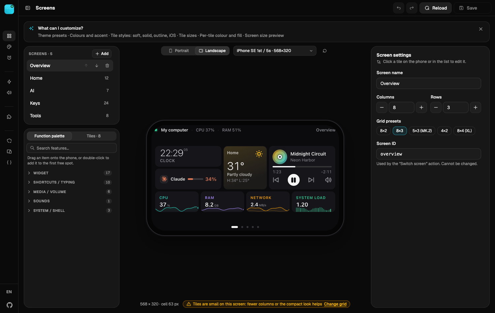
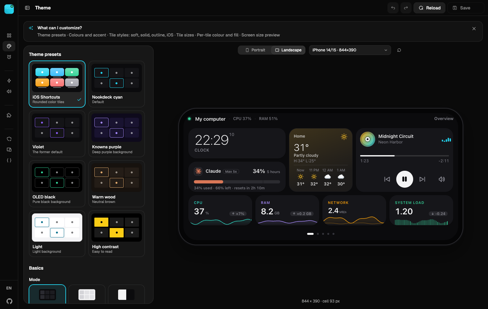
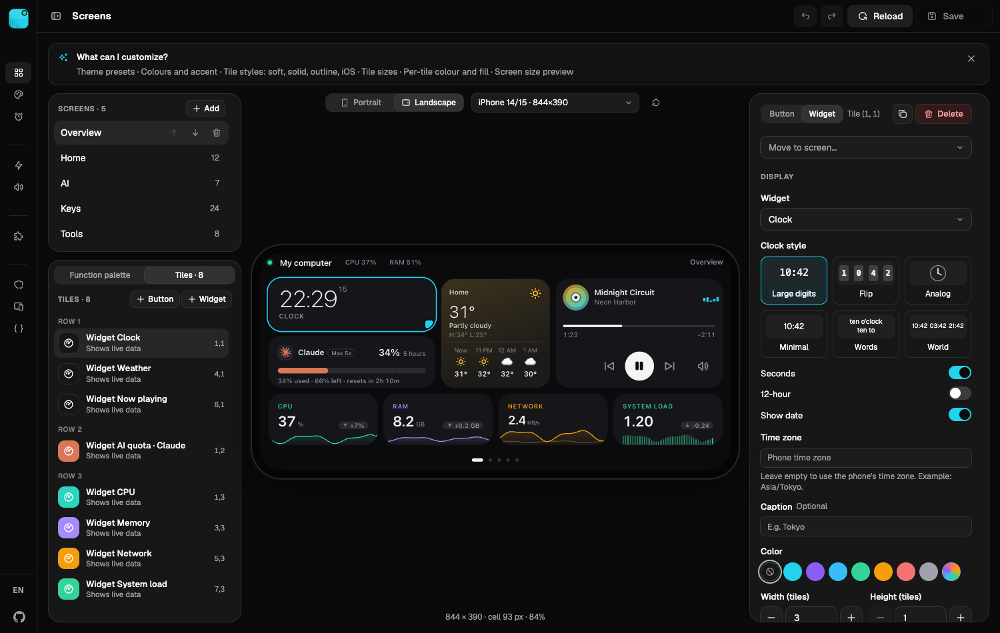

<p align="center">
  
</p>

<h1 align="center">Nookdeck</h1>

<p align="center"><b>Votre ancien téléphone devient le panneau de contrôle de votre ordinateur.</b></p>

<p align="center">
  <a href="https://github.com/howznguyen/nookdeck/releases"></a>
  <a href="LICENSE"></a>
  <a href="https://github.com/howznguyen/nookdeck/stargazers"></a>
  
</p>

<p align="center"><a href="README.md">English</a> · <a href="README.vi.md">Tiếng Việt</a> · <a href="README.zh.md">中文</a> · <b>Français</b> · <a href="README.pt.md">Português</a></p>

<p align="center">
  <a href="https://github.com/howznguyen/nookdeck/releases/latest/download/Nookdeck.dmg"><b>Télécharger pour Mac</b></a> ·
  <a href="https://github.com/howznguyen/nookdeck/releases/latest/download/Nookdeck-Setup.exe"><b>Windows</b></a> ·
  <a href="https://github.com/howznguyen/nookdeck/releases/latest"><b>Linux</b></a> ·
  <a href="https://nookdeck.app/fr/themes"><b>Aperçu des thèmes en direct</b></a> ·
  <a href="https://nookdeck.app/fr">nookdeck.app</a>
</p>

<p align="center">
  <a href="https://macgrove.app/apps/nookdeck"></a>
</p>

Transformez un ancien téléphone ou une tablette en panneau de contrôle façon Stream Deck et en tableau de bord pour votre Mac, votre PC Windows ou votre ordinateur Linux.
**Tout se passe dans le navigateur du téléphone : iPhone, iPad et téléphones Android fonctionnent, même un vieil iPhone bloqué sur iOS 12.**
Nookdeck est un petit agent installé sur votre ordinateur, qui sert le panneau tactile sur votre Wi-Fi : pas d'app sur le téléphone, pas
de compte, pas de cloud.

> **État :** version précoce (0.x). macOS est la cible principale, Windows et Linux sont expérimentaux. Les builds ne sont ni signés avec un Developer ID ni notarisés : voir [Installation](#installation).

<p align="center"></p>

## Ce que vous pouvez faire

| Pour | Sur le téléphone |
|---|---|
| **Raccourcis** | Ouvrir des apps (avec leurs vraies icônes) et des URL, combinaisons de touches, saisie de texte, commandes shell, macros, touches multimédia et volume, captures d'écran (l'outil du système, ou Snapzy, CleanShot X et Shottr sur Mac, ShareX et Greenshot sur Windows) |
| **Surveillance** | CPU, mémoire, réseau, charge et temps de fonctionnement, avec plusieurs styles de graphique ; touchez le CPU pour voir la liste des processus |
| **Code avec l'IA** | Quotas Claude, Codex et Antigravity avec leur heure de réinitialisation, pour plusieurs comptes Claude et profils Codex ; choisissez les fenêtres à afficher (5 heures, 7 jours, par modèle) ; sessions Claude Code / Codex locales |
| **Claude Code depuis le canapé** | Répondez aux demandes d'autorisation **Autoriser / Refuser** et aux questions à choix multiples de Claude depuis le téléphone (hooks à activer) |
| **On Air** | Une tuile ON AIR et un panneau plein écran qui s'allument quand le micro ou la caméra sert, depuis un bouton, via `POST /api/onair` ou pendant qu'OBS diffuse ou enregistre ; les boutons **Micro** et **Caméra** coupent le micro et allument ou éteignent la caméra dans Zoom, Teams ou Google Meet |
| **Au quotidien** | En cours de lecture avec pochette et reprise, 6 styles d'horloge et horloges mondiales, météo (par heure et par jour, °C ou °F), table de sons, notifications |
| **Home Assistant** | Lumières avec couleur, température de couleur, scènes et effets ; climatisation (mode, ventilation, oscillation), ventilateurs, volets, aspirateurs, serrures, capteurs et images des caméras (facultatif) |
| **Automatisation** | Webhooks qui envoient des valeurs et des notifications, règles qui réagissent à l'activité de l'ordinateur |
| **À votre goût** | Grille en glisser-déposer (8×4, 8×3, 5×3…) avec un aperçu pour chaque taille d'écran, 4 styles de tuile (Soft, Solid, Outline, iOS), une couleur au choix par tuile, plus de 5 000 icônes, en anglais, vietnamien, chinois simplifié, français ou portugais du Brésil |
| **Plugins** | Ajoutez des tuiles et des boutons (OBS, Water reminder, Stocks, Pomodoro et d'autres) depuis la [boutique de plugins](https://nookdeck.app/fr/plugins) ([nookdeck-plugins](https://github.com/howznguyen/nookdeck-plugins)), ou créez les vôtres en TypeScript : voir le [guide des plugins](docs/plugins.md) |
| **Thèmes** | 15 packs de thèmes (Catppuccin, Tokyo Night, Cyberpunk, Sketchbook, Pixel…) en clair et en sombre, un mode Auto qui suit le téléphone, polices et arrière-plans ; [aperçu en direct](https://nookdeck.app/fr/themes) ou créez le vôtre |

La disposition est une grille fixe de tuiles carrées, que vous composez par glisser-déposer dans la page de gestion, à l'adresse `http://localhost:7420/manage/`.
Un serveur MCP permet à un assistant IA d'organiser la disposition pour vous. Fonctionne sur macOS, et sur Windows 10/11 et Linux (expérimental).

## Captures d'écran

<p align="center"></p>

<p align="center"><br><sub>Quelques-uns des 15 packs de thèmes. <a href="https://nookdeck.app/fr/themes">Tous les voir en direct</a>.</sub></p>

<table>
<tr>
<td width="50%"></td>
<td width="50%"></td>
</tr>
<tr>
<td align="center"><b>Répondre à Claude Code depuis le téléphone</b></td>
<td align="center"><b>Quotas et sessions IA</b></td>
</tr>
<tr>
<td width="50%"></td>
<td width="50%"></td>
</tr>
<tr>
<td align="center"><b>Touches façon Stream Deck</b></td>
<td align="center"><b>Home Assistant</b></td>
</tr>
</table>

## Installation

Il vous faut un **Mac** (macOS 13 ou plus récent), un **PC Windows 10/11** ou un **ordinateur Linux** ([expérimental](docs/install.md#on-linux-experimental)), et un **téléphone ou une tablette sur le même Wi-Fi**. Rien
n'est installé sur le téléphone. Comptez environ 2 minutes.

### 1. Installer sur l'ordinateur

**L'application (sans Terminal)**

1. Téléchargez **[Nookdeck.dmg](https://github.com/howznguyen/nookdeck/releases/latest/download/Nookdeck.dmg)** (Mac) ou **[Nookdeck-Setup.exe](https://github.com/howznguyen/nookdeck/releases/latest/download/Nookdeck-Setup.exe)** (Windows).
2. **Mac :** ouvrez le dmg, glissez **Nookdeck** dans **Applications**, puis ouvrez-le. **Windows :** lancez l'installateur (pas besoin d'être administrateur).
3. Nookdeck apparaît dans la barre des menus (Mac) ou dans la zone de notification (Windows). Cliquez dessus et choisissez **Associer un téléphone…** pour afficher le QR code et le code PIN.

À la première ouverture de l'app sur Mac, macOS peut indiquer qu'il ne peut pas vérifier l'absence de logiciel malveillant, car Nookdeck n'est pas encore signé avec un Apple Developer ID. Cela n'arrive qu'une fois : ouvrez **Réglages Système → Confidentialité et sécurité**, descendez jusqu'au message concernant Nookdeck, cliquez sur **Ouvrir quand même** et confirmez. Sur Windows, SmartScreen peut afficher « Windows a protégé votre ordinateur » : cliquez sur **Informations complémentaires → Exécuter quand même**.

L'app ne fait que piloter Nookdeck. La quitter n'arrête pas le panneau sur votre téléphone. Étapes complètes et aide : [docs/install.md](docs/install.md).

**Ou une ligne dans un terminal**, qui fait la même chose sans l'app :

**Sur Mac**

1. Ouvrez **Terminal** : appuyez sur <kbd>⌘ Command</kbd> + <kbd>Espace</kbd>, tapez `Terminal`, appuyez sur <kbd>Retour</kbd>.
2. Copiez cette ligne, collez-la dans Terminal, appuyez sur <kbd>Retour</kbd> :

```sh
curl -fsSL https://nookdeck.app/scripts/install | bash
```

**Sur Windows** (expérimental)

1. Ouvrez **PowerShell** : cliquez sur **Démarrer**, tapez `PowerShell`, appuyez sur <kbd>Entrée</kbd> (pas besoin d'être administrateur).
2. Copiez cette ligne, collez-la dans PowerShell, appuyez sur <kbd>Entrée</kbd> :

```powershell
irm https://nookdeck.app/scripts/install.ps1 | iex
```

**Sur Linux** (expérimental)

Sur Ubuntu ou Debian, téléchargez `nookdeck_<version>_amd64.deb` (`_arm64.deb` sur ARM) depuis la [dernière version](https://github.com/howznguyen/nookdeck/releases/latest), puis installez-le depuis le dossier où vous l'avez enregistré :

```sh
sudo apt install ./nookdeck_*_amd64.deb
```

Ouvrez ensuite **Nookdeck** depuis le menu des applications. Au premier lancement, l'app installe Nookdeck pour votre utilisateur et ajoute une icône dans la zone de notification. Si vous préférez vous passer de l'app, la ligne pour Mac ci-dessus fonctionne aussi sur Linux (sans `sudo`) :

```sh
curl -fsSL https://nookdeck.app/scripts/install | bash
```

À savoir sur Linux :

- Prévu pour Ubuntu 22.04 et 24.04 et Debian 12 et 13, sur x86_64 ou ARM64. Fedora (`.rpm`) est pris en charge sans garantie.
- Les touches et la saisie utilisent `xdotool` sous X11. Sous Wayland, il faut `ydotool` et un accès en écriture à `/dev/uinput` : lancez `nookdeck doctor`, il affiche la correction adaptée à votre système.
- Debian avec GNOME n'affiche pas d'icônes dans la zone de notification tant que l'extension AppIndicator (`gnome-shell-extension-appindicator`) n'est pas installée et activée ; déconnectez-vous puis reconnectez-vous ensuite. Ubuntu l'a déjà. Tout fonctionne aussi depuis la page de gestion et la commande `nookdeck`.
- Les autres méthodes (`.rpm`, une archive tarball) et les détails : [docs/install.md](docs/install.md#on-linux-experimental).

Lien direct, si `nookdeck.app` est bloqué sur votre réseau : remplacez `https://nookdeck.app/scripts/install` par `https://raw.githubusercontent.com/howznguyen/nookdeck/main/setup.sh` (Windows : `https://raw.githubusercontent.com/howznguyen/nookdeck/main/setup.ps1`).

Vous verrez une barre de téléchargement, puis quelques lignes `OK`. À la fin, Nookdeck affiche un **QR code**, une **adresse pour le téléphone**
(par exemple `http://your-mac.local:7420`) et un **code PIN à 6 chiffres**. Gardez cette fenêtre ouverte pour l'étape suivante.

Nookdeck démarre désormais tout seul à chaque ouverture de session, et la commande `nookdeck` fonctionne dans toute nouvelle fenêtre de terminal.

### 2. L'ouvrir sur le téléphone

- **Le plus simple :** ouvrez l'**Appareil photo** du téléphone et visez le QR code affiché sur l'ordinateur. Touchez le lien qui apparaît.
- **Ou** tapez l'adresse dans le navigateur du téléphone et saisissez le code PIN.

Le téléphone s'en souvient : il suffit de le faire une fois. Pour un panneau en plein écran, ajoutez-le à l'écran d'accueil :

- **iPhone (Safari) :** touchez **Partager** → **Sur l'écran d'accueil**.
- **Android (Chrome) :** touchez **⋮** → **Ajouter à l'écran d'accueil**.

### 3. À votre goût

Sur l'ordinateur, ouvrez **http://localhost:7420/manage/** dans votre navigateur. Glissez des apps, des raccourcis et des widgets sur
l'aperçu du téléphone, puis appuyez sur **Enregistrer**. Le téléphone se met à jour aussitôt.

- **Taille d'écran :** choisissez votre téléphone (iPhone 5s/SE, iPhone, Pro Max, Android, iPad ou une taille personnalisée) au-dessus de l'aperçu
  pour voir exactement ce qu'il affichera. Un avertissement apparaît quand les tuiles deviennent trop petites pour être touchées.
- **Thème :** le mode, les coins, le style des tuiles, l'orientation et la couleur d'accent se choisissent sur des cartes illustrées : vous voyez
  le résultat avant de choisir.
- **Chaque tuile :** sa couleur, son style de remplissage et sa taille (de 1×1 à 4×3) se choisissent sur de petits aperçus.

<table>
<tr><td colspan="2"></td></tr>
<tr>
<td width="50%"></td>
<td width="50%"></td>
</tr>
</table>

La première fois qu'une touche envoie un raccourci, macOS demande l'autorisation **Accessibilité** : acceptez-la (Réglages Système →
Confidentialité et sécurité → Accessibilité). Windows demande une fois d'autoriser Nookdeck sur le réseau : acceptez.

### Quelque chose ne marche pas ?

| Problème | Que faire |
|---|---|
| Le téléphone n'arrive pas à ouvrir l'adresse | Vérifiez que le téléphone et l'ordinateur sont sur le **même Wi-Fi**. Sur Windows, autorisez Nookdeck quand le pare-feu le demande. Essayez l'adresse en chiffres affichée par l'installateur (`http://192.168…:7420`). |
| `could not reach GitHub` ou `error: 503` | GitHub a eu un raté. Attendez quelques secondes et relancez la même ligne. |
| Le téléchargement est lent | Il fait environ 20 Mo (40 Mo sur Windows). Laissez-le tourner, la barre indique la progression. |
| `nookdeck: command not found` | Ouvrez une **nouvelle** fenêtre de terminal. |
| Une touche ne fait rien sur Mac | Autorisez **Accessibilité** pour Nookdeck, puis lancez `nookdeck doctor` pour voir ce qui manque encore. |
| Les touches ne marchent plus après une mise à jour | macOS lie l'autorisation Accessibilité à chaque build. Dans la page de gestion, onglet **Autorisations**, appuyez sur **Réinitialiser et redemander** (ou lancez `nookdeck doctor --request accessibility --reset`) et activez nookdeck. |
| L'adresse `.local` ne s'ouvre pas sur un vieux téléphone | Utilisez l'adresse IP affichée par l'installateur, et donnez une IP fixe à l'ordinateur dans votre box pour qu'elle ne change pas. |
| `port 7420 is in use` | Un autre programme utilise ce port. Relancez l'installateur avec `--port 7421` (Mac : `… \| bash -s -- --port 7421`). |

### Mettre à jour ou désinstaller

Vous veniez de PhoneDesk ? Nookdeck est son nouveau nom : une mise à jour reprend automatiquement votre disposition, vos téléphones et vos réglages.

- **Mettre à jour :** l'app vous prévient quand une nouvelle version sort, montre ce qui change et l'installe. Vous pouvez aussi relancer la même ligne d'installation. Votre disposition et vos téléphones associés sont conservés.
- **Désinstaller (Mac) :** `curl -fsSL https://nookdeck.app/scripts/uninstall | bash`. Vos données sont conservées ; ajoutez `-s -- --purge` après `bash` pour les supprimer aussi.
- **Désinstaller (Windows) :** `irm https://nookdeck.app/scripts/uninstall.ps1 | iex`.
- **Désinstaller (Linux) :** la même ligne que sur Mac. Si vous avez installé le `.deb`, lancez aussi `sudo apt remove nookdeck`.

<details>
<summary>Autres options et détails de l'installateur</summary>

- L'installateur télécharge le bon fichier depuis la [dernière version](https://github.com/howznguyen/nookdeck/releases/latest), vérifie
  son SHA-256 avec `SHA256SUMS` et s'arrête en cas d'écart, l'installe pour votre utilisateur seulement (sans `sudo` ni droits
  administrateur), le lance à l'ouverture de session (un agent launchd sur macOS, une tâche du Planificateur de tâches sur Windows, un service utilisateur systemd sur Linux) et l'ajoute à votre PATH.
- Les options sur Mac se placent après `bash -s --` : `--yes` (sans questions), `--version 0.1.1`, `--port 7421`, `--no-autostart`,
  `--no-open`, `--no-path`, `--dry-run`. Sur Windows, définissez des variables d'environnement avant la ligne, par exemple
  `$env:NOOKDECK_PORT=7421; irm … | iex` (voir le début de [setup.ps1](setup.ps1)).
- Fichiers : le programme est `~/.nookdeck/bin/nookdeck` sur macOS et Linux, et `%LOCALAPPDATA%\Nookdeck\bin\nookdeck.exe` sur
  Windows ; vos données sont dans `~/.nookdeck` ; les journaux dans `~/.nookdeck/logs`.
- Service en arrière-plan : `nookdeck service install|uninstall|status|restart`.
- Signature : les binaires sont signés ad hoc, pas avec un Apple Developer ID ni un certificat Windows. Les installateurs s'en
  occupent ; un fichier téléchargé dans un navigateur peut demander `xattr -d com.apple.quarantine <file>` sur macOS, ou « Informations
  complémentaires → Exécuter quand même » dans Windows SmartScreen.
- Problème connu sur Windows : les touches qui saisissent du texte peuvent produire de mauvais caractères. L'ouverture d'apps, les raccourcis, le multimédia et le volume fonctionnent.

</details>

## Plugins

- **Boutique :** dans la page de gestion, ouvrez **Plugins** → **Découvrir**, ou parcourez [nookdeck.app/fr/plugins](https://nookdeck.app/fr/plugins) et appuyez sur **Ouvrir dans Nookdeck**. Chaque plugin de la liste est vérifié et figé sur ses fichiers ([nookdeck-plugins](https://github.com/howznguyen/nookdeck-plugins)).
- **Depuis GitHub :** collez le lien d'un dépôt ou d'un dossier dans **Plugins** → **Installer depuis un lien**. Les plugins hors de la liste sont marqués Non vérifié.
- **En créer un :** un `nookdeck.json` pour de simples tuiles et boutons, ou du TypeScript avec le SDK `@nookdeck/plugin`. Commencez par `nookdeck plugin new`, lisez le [guide des plugins](docs/plugins.md), puis ouvrez une pull request sur [nookdeck-plugins](https://github.com/howznguyen/nookdeck-plugins) pour être listé.

## Thèmes

- **Choisir un style :** dans la page de gestion, ouvrez **Thème** → **Packs**. Catppuccin, Tokyo Night, Night Owl, One Dark Pro, JellyFish, SynthWave '84 et Cyberpunk sont dans la boutique, à côté des styles Nookdeck intégrés. Chaque pack a des variantes (comme Latte et Mocha) et un mode **Auto** pour le clair et le sombre. Choisissez-en un, appuyez sur **Appliquer**, et annulez si cela ne vous plaît pas.
- **Créer le vôtre :** réglez le style dans **Thème** → **Personnaliser**, appuyez sur **Exporter cette apparence**, modifiez les fichiers et installez-les à nouveau. Les thèmes sont des données et du CSS, ils ne peuvent pas exécuter de code. Voir le [guide des thèmes](docs/themes.md).
- **Le partager :** ouvrez une pull request sur [nookdeck-plugins](https://github.com/howznguyen/nookdeck-plugins) (`themes/`) pour être listé.

## Installer depuis les sources

Prérequis : macOS 13+ (Apple silicon ou Intel), Windows 10/11 x64 (expérimental) ou Linux x86_64/ARM64 (expérimental).

Depuis les sources (il faut [Bun](https://bun.sh) 1.3+) :

```sh
git clone https://github.com/howznguyen/nookdeck && cd nookdeck
bun install
bun run build          # construit les apps web et dist/nookdeck
./dist/nookdeck       # affiche l'URL pour le téléphone et un code PIN d'association
```

Sur Windows, `bun run build:win` produit `dist/nookdeck-windows-x64.exe`.

Ouvrez l'URL affichée sur votre téléphone (même Wi-Fi), saisissez le code PIN et ajoutez la page à l'écran d'accueil pour un
panneau en plein écran. La page de gestion se trouve à `http://localhost:7420/manage/` sur le Mac.

macOS demande l'autorisation **Accessibilité** la première fois qu'une tuile envoie des touches.

## Intégration Claude Code (facultative)

Dans la page de gestion, section **AI**, deux interrupteurs distincts installent des hooks dans `~/.claude/settings.json` (une sauvegarde est faite d'abord) :

- **Demandes d'autorisation** : un hook `PermissionRequest` affiche Autoriser / Refuser sur le téléphone.
- **Questions** : un hook `PreToolUse` pour `AskUserQuestion` affiche les options de Claude sur le téléphone et renvoie votre
  choix. Au choix, seulement quand vous êtes loin du clavier.

Si aucun téléphone ne répond à temps, Claude Code pose la question dans le terminal comme d'habitude. Pour Codex, le hook d'autorisation va dans
`~/.codex/hooks.json`.

Les quotas sont en lecture seule : Nookdeck lit la connexion que Claude Code a déjà enregistrée (sans jamais la renouveler), les fichiers
de session locaux de Codex et le serveur local d'Antigravity. Voir [PRIVACY.md](PRIVACY.md) pour chaque connexion sortante. L'app n'envoie aucune télémétrie ; seuls l'installateur et le site comptent les installations (de façon anonyme, désactivable avec `NOOKDECK_NO_ANALYTICS=1`, voir [Statistiques d'installation](PRIVACY.md#install-statistics-website-and-installer)).

## Autorisations

macOS lie chaque autorisation au programme qui la demande. Avec le service en arrière-plan, c'est le binaire `nookdeck` ; lancé depuis un terminal, c'est l'app du terminal. Lancez `nookdeck doctor` pour voir ce qui est accordé (il interroge l'agent en cours d'exécution et n'affiche jamais de demande de lui-même) :

| Autorisation | Sert à | Où |
|---|---|---|
| Accessibilité | tuiles de touches, de saisie et de volume | Confidentialité et sécurité > Accessibilité |
| Automatisation : System Events, Musique, Spotify | tuiles de touches, En cours de lecture et touches multimédia | Confidentialité et sécurité > Automatisation |
| Trousseau : Claude Code | quota d'utilisation de Claude (lecture seule) | macOS demande une fois : choisissez Toujours autoriser |
| Réseau local | Home Assistant sur votre réseau local | Confidentialité et sécurité > Réseau local |
| Coupe-feu | connexion des téléphones à l'agent | Réseau > Coupe-feu > Options |

```bash
nookdeck doctor                          # ✓ / ✗ pour chaque élément, avec la correction
nookdeck doctor --open accessibility     # ouvre le bon panneau des Réglages
nookdeck doctor --request accessibility  # fait apparaître nookdeck dans la liste de macOS (affiche sa demande)
```

Les mises à jour sont signées ad hoc, donc macOS peut redemander après une mise à jour : retirez l'ancienne entrée `nookdeck` de la liste de confidentialité et ajoutez-la à nouveau. Cela disparaîtra quand les versions seront signées avec un Developer ID.

**Sur Windows**, `nookdeck doctor` vérifie d'autres choses (mêmes commandes, `nookdeck doctor --open firewall` ouvre Sécurité Windows) :

| Vérification | Pourquoi c'est important |
|---|---|
| Pare-feu | Windows bloque les connexions entrantes sauf si une règle autorise `nookdeck.exe` ; l'installateur propose une règle, limitée à votre sous-réseau local (une demande UAC, supprimée par `uninstall.ps1`). À la main, en administrateur : `netsh advfirewall firewall add rule name="Nookdeck" dir=in action=allow program="<path>\nookdeck.exe" profile=any remoteip=localsubnet` |
| Profil réseau | Votre Wi-Fi ou Ethernet doit être un réseau privé (Paramètres > Réseau et Internet) |
| Session de bureau | Les touches, la saisie, En cours de lecture et le volume ne fonctionnent que si Nookdeck tourne dans votre session de bureau ouverte (c'est le cas de la tâche planifiée ; pas d'une session SSH ni d'un service Windows) |
| Assistant PowerShell | En cours de lecture, le volume, les icônes d'apps et la liste des processus passent par un petit assistant Windows PowerShell 5.1 |
| SmartScreen | Un `nookdeck.exe` téléchargé qui porte la marque Internet déclenche des avertissements ; l'installateur la retire |

**Sur Linux** (expérimental), il n'y a pas de demande d'autorisation. `nookdeck doctor` vérifie les outils utilisés par Nookdeck et affiche la commande qui corrige chacun d'eux ; il ne modifie jamais votre système de lui-même :

| Vérification | Pourquoi c'est important |
|---|---|
| Service | Nookdeck tourne comme service utilisateur systemd (`nookdeck service status`, journaux dans `~/.nookdeck/logs`), ou via une entrée de démarrage automatique là où il n'y a pas de session utilisateur systemd |
| Touches et saisie | X11 : `xdotool`. Wayland : `ydotool` (la version 1.x demande aussi que `ydotoold` tourne) et un accès en écriture à `/dev/uinput`, via le groupe `input` ou une règle udev |
| Multimédia et volume | En cours de lecture s'appuie sur `playerctl`, le volume sur `pactl` (`pulseaudio-utils`, fonctionne aussi avec PipeWire) |
| Pare-feu | Quand `ufw` est actif, le téléphone ne peut pas se connecter tant que le port n'est pas ouvert : doctor affiche la ligne `sudo ufw allow` |

## Assistant IA de disposition (MCP)

Nookdeck inclut un serveur MCP : Claude Code (ou tout client MCP) peut organiser votre panneau en langage courant, par exemple « ajoute une page avec mes outils de dev » ou « mets Spotify à côté de l'horloge ». Il parle à l'agent en cours d'exécution, donc lancez Nookdeck d'abord.

Enregistrez-le une fois, avec le chemin utilisé par l'installateur :

| Installé avec | Commande |
|---|---|
| `setup.sh` (macOS, Linux) | `claude mcp add nookdeck -- ~/.nookdeck/bin/nookdeck mcp` |
| `setup.ps1` (Windows) | `claude mcp add nookdeck -- "%LOCALAPPDATA%\Nookdeck\bin\nookdeck.exe" mcp` |
| Construit depuis les sources | `claude mcp add nookdeck -- /chemin/complet/vers/dist/nookdeck mcp` |

Ajoutez `--port N` après `mcp` si l'agent n'utilise pas le port 7420, et `--scope user` avant `nookdeck` pour le rendre disponible dans tous vos projets. Vérifiez avec `claude mcp list`.

Outils : `get_layout`, `add_page`, `add_item`, `update_item`, `move_item`, `resize_item`, `remove_item`, `update_page`, `remove_page`, `set_theme`, `list_apps`, `list_widgets`, `search_icons`, `preview_changes`, `undo`. Chaque modification passe par la même validation que la page de gestion et peut être annulée. La [skill de disposition](docs/skills/nookdeck-layout/SKILL.md) décrit le schéma à l'assistant.

## Sécurité

- L'agent écoute sur votre réseau local. Les téléphones doivent être associés avec un code PIN à 6 chiffres ; le jeton de l'appareil est conservé dans un cookie.
- L'API de gestion ne répond que sur `localhost` et refuse les requêtes intersites et le DNS rebinding.
- Les tuiles peuvent exécuter les commandes shell que vous configurez. N'associez que des appareils de confiance.

## Développement

```sh
bun run dev     # agent en mode watch
bun run test    # tests unitaires
```

Organisation : `src/` l'agent (Bun + TypeScript), `web/deck` l'interface du téléphone (Preact, Safari 12+), `web/manage` la page de gestion
(React), `web/shared` le code commun aux deux.

## Contribuer

Les pull requests, les rapports de bug et les traductions sont les bienvenus. Lisez [CONTRIBUTING.md](CONTRIBUTING.md) (en anglais) pour l'environnement de développement, l'organisation du projet et les règles qu'une pull request doit suivre.

```sh
bun install
bun test
bun run build
```

Les bugs et les idées vont dans les [issues GitHub](https://github.com/howznguyen/nookdeck/issues). Pour une vulnérabilité, merci de la signaler en privé : voir [Security](CONTRIBUTING.md#security).

### Contributeurs

<a href="https://github.com/howznguyen/nookdeck/graphs/contributors"></a>

Merci à :

- [Ron Ng (ronnhd)](https://github.com/ronnhd) : pochettes vinyle et corrections des pochettes dans En cours de lecture.
- [Howie989](https://github.com/Howie989) : traduction en chinois simplifié.

## Soutenir le projet

Nookdeck est gratuit et développé sur mon temps libre. S'il vous est utile :

- **Mettez une étoile au dépôt** sur GitHub : cela aide d'autres personnes à trouver Nookdeck.
- **Offrez-moi un café** sur [Ko-fi](https://ko-fi.com/howznguyen).
- **Parlez-en autour de vous**, ou [partagez un plugin ou un thème](https://github.com/howznguyen/nookdeck-plugins).

<p><a href="https://ko-fi.com/howznguyen"></a> <a href="https://github.com/howznguyen/nookdeck/stargazers"></a></p>

## Crédits

- Icônes : [Tabler Icons](https://tabler.io/icons) (MIT) et [LobeHub Icons](https://github.com/lobehub/lobe-icons) (MIT).
- Composants d'interface : [Knowns UI](https://ui.knowns.dev).
- Données météo : [Open-Meteo](https://open-meteo.com) (CC BY 4.0).

## Auteur

[howznguyen](https://github.com/howznguyen) | Vietnamien

## Licence

[MIT](LICENSE)
