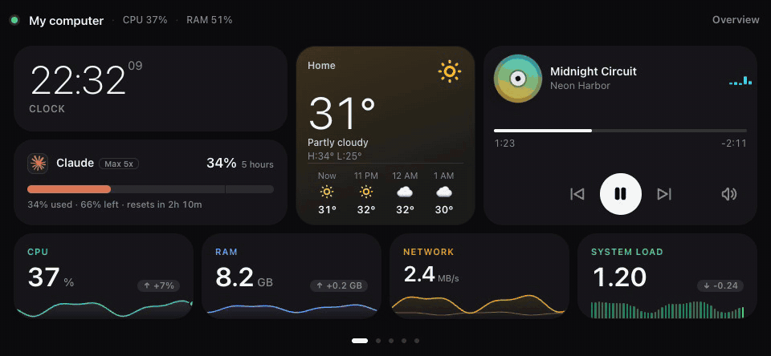
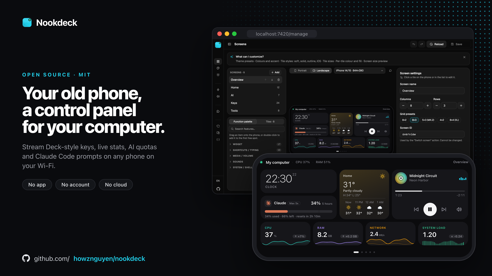
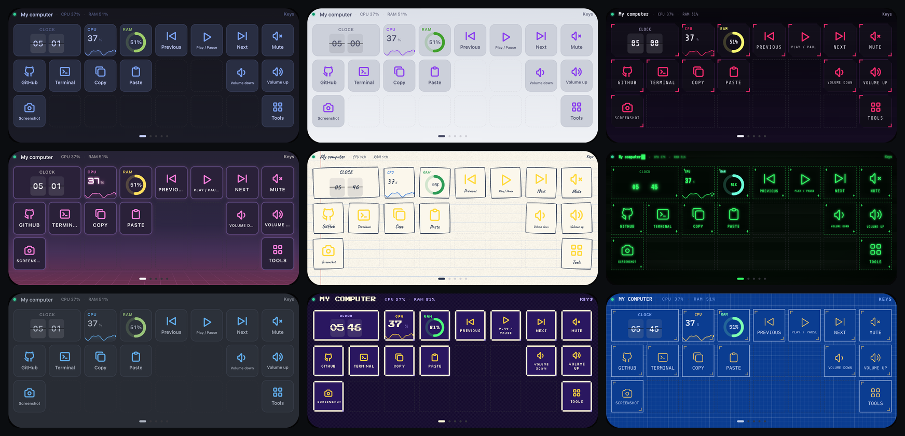
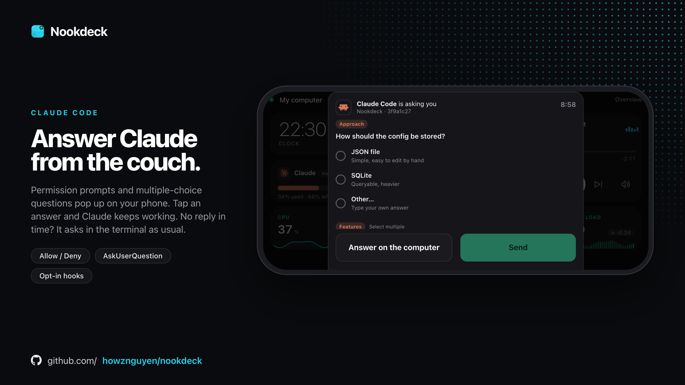
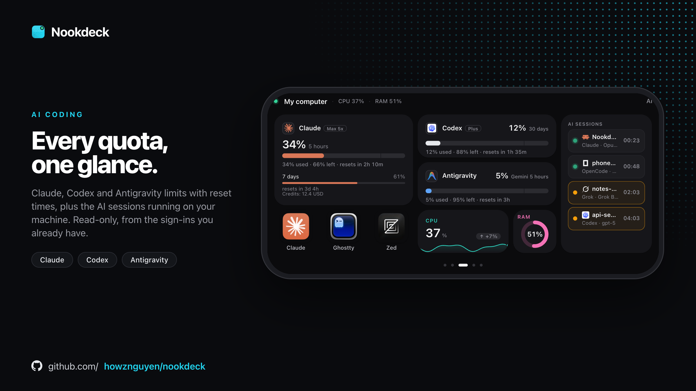
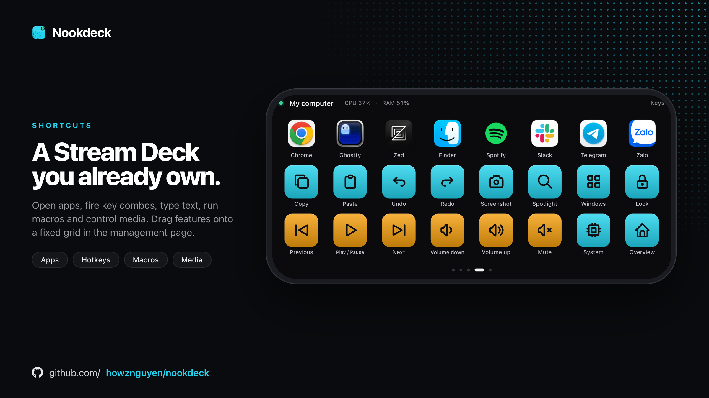
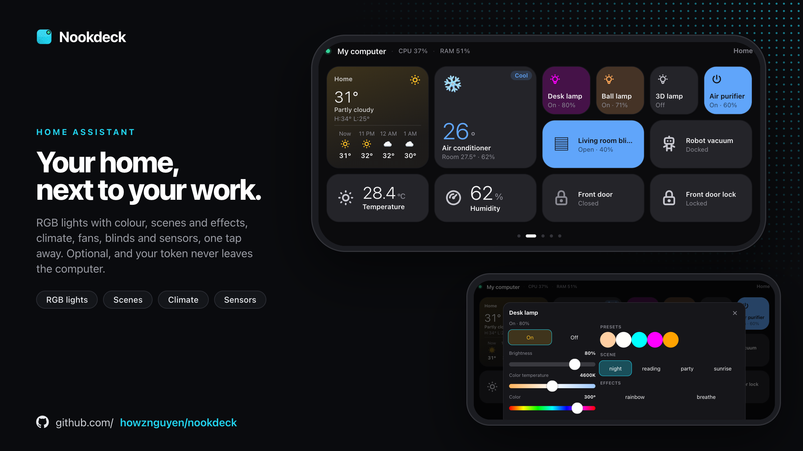
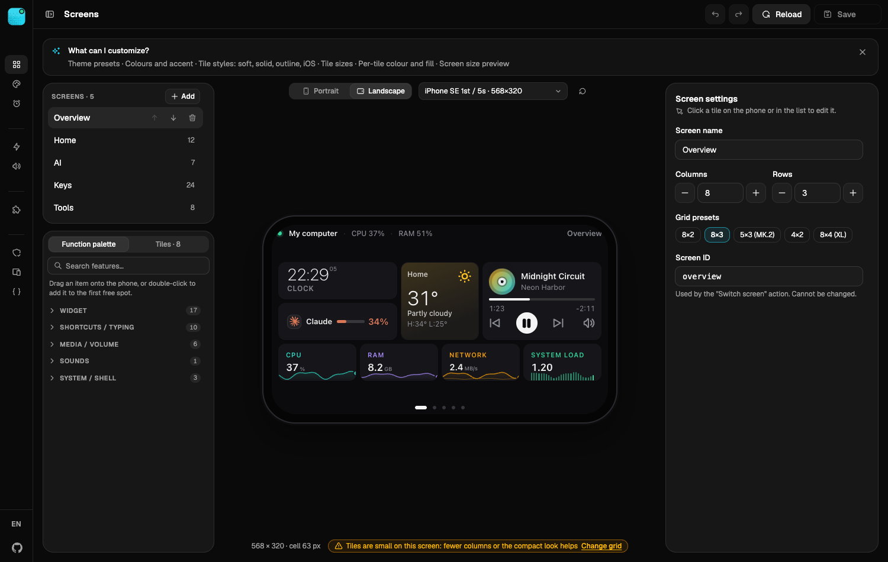
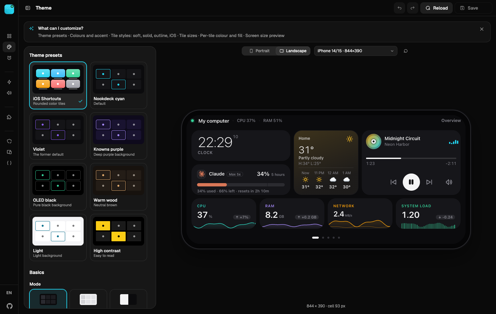
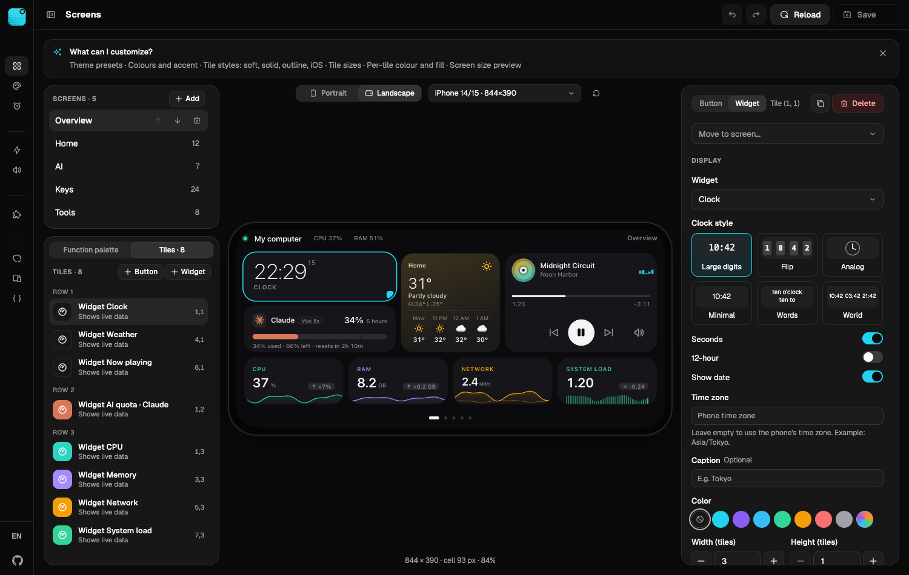

<p align="center">
  
</p>

<h1 align="center">Nookdeck</h1>

<p align="center"><b>Your old phone, a control panel for your computer.</b></p>

<p align="center">
  <a href="https://github.com/howznguyen/nookdeck/releases"></a>
  <a href="LICENSE"></a>
  <a href="https://github.com/howznguyen/nookdeck/stargazers"></a>
  
</p>

<p align="center"><b>English</b> · <a href="README.vi.md">Tiếng Việt</a> · <a href="README.zh.md">中文</a></p>

<p align="center">
  <a href="https://github.com/howznguyen/nookdeck/releases/latest/download/Nookdeck.dmg"><b>Download for Mac</b></a> ·
  <a href="https://github.com/howznguyen/nookdeck/releases/latest/download/Nookdeck-Setup.exe"><b>Windows</b></a> ·
  <a href="https://github.com/howznguyen/nookdeck/releases/latest"><b>Linux</b></a> ·
  <a href="https://nookdeck.app/themes"><b>Live theme previews</b></a> ·
  <a href="https://nookdeck.app">nookdeck.app</a>
</p>

<p align="center">
  <a href="https://macgrove.app/apps/nookdeck"></a>
</p>

Turn an old phone or tablet into a Stream Deck-style control panel and dashboard for your Mac, Windows PC or Linux computer.
**It runs in the phone's browser, so iPhones, iPads and Android phones all work, even an old iPhone stuck on iOS 12.**
Nookdeck is a small agent on your computer that serves the touch panel over your Wi-Fi: no app on the phone, no
account, no cloud.

> **Status:** early (0.x). macOS is the main target, Windows and Linux are experimental. Builds are not signed with a Developer ID or notarized: see [Install](#install).

<p align="center"></p>

## What you can do

| Use it for | On the phone |
|---|---|
| **Shortcuts** | Open apps (with their real icons) and URLs, key combinations, type text, shell commands, macros, media and volume keys |
| **Monitoring** | CPU, memory, network, load and uptime with selectable chart styles; tap CPU for the process list |
| **AI coding** | Claude, Codex and Antigravity quotas with reset times; pick which windows to show (5 hours, 7 days, per model); local Claude Code / Codex sessions |
| **Claude Code from the couch** | Answer **Allow / Deny** permission prompts and Claude's multiple-choice questions on the phone (opt-in hooks) |
| **Everyday** | Now Playing with artwork and Resume, 6 clock styles and world clocks, weather (hourly and daily, °C or °F), a soundboard, notifications |
| **Home Assistant** | Lights with colour, colour temperature, scenes and effects; climate (mode, fan, swing), fans, covers, vacuums, locks, sensors and camera stills (optional) |
| **Automation** | Webhooks that push values and notifications, rules that react to activity on the computer |
| **Make it yours** | Drag-and-drop grid (8×4, 8×3, 5×3…) with a preview for every screen size, 4 tile styles (Soft, Solid, Outline, iOS), any colour per tile, 5,000+ icons, English, Vietnamese or Simplified Chinese |
| **Plugins** | Add tiles and buttons from the [plugin Store](https://nookdeck.app/plugins) ([nookdeck-plugins](https://github.com/howznguyen/nookdeck-plugins)), or build your own in TypeScript: see the [plugin guide](docs/plugins.md) |
| **Themes** | 15 theme packs (Catppuccin, Tokyo Night, Cyberpunk, Sketchbook, Pixel…) with light and dark variants, an Auto mode that follows the phone, fonts and backgrounds; [preview them live](https://nookdeck.app/themes) or make your own |

The layout is a fixed grid of square tiles built in a drag-and-drop management page at `http://localhost:7420/manage/`.
An MCP server lets an AI assistant arrange the layout for you. Runs on macOS, and on Windows 10/11 (experimental).

## Screenshots

<p align="center"></p>

<p align="center"><br><sub>A few of the 15 theme packs. <a href="https://nookdeck.app/themes">Preview them all live</a>.</sub></p>

<table>
<tr>
<td width="50%"></td>
<td width="50%"></td>
</tr>
<tr>
<td align="center"><b>Answer Claude Code from your phone</b></td>
<td align="center"><b>AI quotas and sessions</b></td>
</tr>
<tr>
<td width="50%"></td>
<td width="50%"></td>
</tr>
<tr>
<td align="center"><b>Stream Deck-style keys</b></td>
<td align="center"><b>Home Assistant</b></td>
</tr>
</table>

## Install

You need a **Mac** (macOS 13 or later), a **Windows 10/11 PC** or a **Linux computer** ([experimental](docs/install.md#on-linux-experimental)), and a **phone or tablet on the same Wi-Fi**. Nothing
is installed on the phone. It takes about 2 minutes.

### 1. Install on the computer

**The app (no Terminal needed)**

1. Download **[Nookdeck.dmg](https://github.com/howznguyen/nookdeck/releases/latest/download/Nookdeck.dmg)** (Mac) or **[Nookdeck-Setup.exe](https://github.com/howznguyen/nookdeck/releases/latest/download/Nookdeck-Setup.exe)** (Windows).
2. **Mac:** open the dmg and drag **Nookdeck** into **Applications**, then open it. **Windows:** run the installer (no administrator needed).
3. Nookdeck appears in the menu bar (Mac) or the system tray (Windows). Click it and choose **Pair a phone…** to see the QR code and PIN.

The first time you open the Mac app, macOS may say it cannot check it for malicious software, because Nookdeck is not signed with an Apple Developer ID yet. This happens once: open **System Settings → Privacy & Security**, scroll down to the message about Nookdeck, click **Open Anyway**, and confirm. On Windows, SmartScreen may show "Windows protected your PC": click **More info → Run anyway**.

The app only controls Nookdeck. Quitting it does not stop your phone panel. Full steps and help: [docs/install.md](docs/install.md).

**Or one line in a terminal**, which does the same without the app:

**On a Mac**

1. Open **Terminal**: press <kbd>⌘ Command</kbd> + <kbd>Space</kbd>, type `Terminal`, press <kbd>Return</kbd>.
2. Copy this line, paste it into Terminal, press <kbd>Return</kbd>:

```sh
curl -fsSL https://nookdeck.app/scripts/install | bash
```

**On Windows** (experimental)

1. Open **PowerShell**: click **Start**, type `PowerShell`, press <kbd>Enter</kbd> (no administrator needed).
2. Copy this line, paste it into PowerShell, press <kbd>Enter</kbd>:

```powershell
irm https://nookdeck.app/scripts/install.ps1 | iex
```

**On Linux** (experimental)

On Ubuntu or Debian, download `nookdeck_<version>_amd64.deb` (`_arm64.deb` on ARM) from the [latest release](https://github.com/howznguyen/nookdeck/releases/latest) and install it from the folder you saved it in:

```sh
sudo apt install ./nookdeck_*_amd64.deb
```

Then open **Nookdeck** from the app menu. On its first start the app sets Nookdeck up for your user and puts an icon in the tray. If you prefer no app, the Mac line above works on Linux too (no `sudo`):

```sh
curl -fsSL https://nookdeck.app/scripts/install | bash
```

What to know on Linux:

- It is meant for Ubuntu 22.04 and 24.04 and Debian 12 and 13, on x86_64 or ARM64. Fedora (`.rpm`) is best effort.
- Keys and typing use `xdotool` on X11. On Wayland they need `ydotool` and write access to `/dev/uinput`: run `nookdeck doctor`, it shows the fix for your system.
- Debian with GNOME shows no tray icons until you install and turn on the AppIndicator extension (`gnome-shell-extension-appindicator`), then log out and back in. Ubuntu has it on already. Everything also works from the manage page and the `nookdeck` command.
- Other ways (`.rpm`, a tarball) and the details: [docs/install.md](docs/install.md#on-linux-experimental).

Direct link, if `nookdeck.app` is blocked on your network: replace `https://nookdeck.app/scripts/install` with `https://raw.githubusercontent.com/howznguyen/nookdeck/main/setup.sh` (Windows: `https://raw.githubusercontent.com/howznguyen/nookdeck/main/setup.ps1`).

You will see a download bar, then a few `OK` lines. At the end Nookdeck prints a **QR code**, a **phone address**
(for example `http://your-mac.local:7420`) and a **6-digit PIN**. Keep that window open for the next step.

Nookdeck now starts by itself every time you sign in, and the `nookdeck` command works in any new terminal window.

### 2. Open it on your phone

- **Easiest:** open the phone's **Camera** and point it at the QR code on the computer. Tap the link that appears.
- **Or** type the phone address into the phone's browser and enter the PIN.

The phone remembers it, so you only do this once. For a full-screen panel, add it to the home screen:

- **iPhone (Safari):** tap **Share** → **Add to Home Screen**.
- **Android (Chrome):** tap **⋮** → **Add to Home screen**.

### 3. Make it yours

On the computer, open **http://localhost:7420/manage/** in your browser. Drag apps, shortcuts and widgets onto the
phone preview, then press **Save**. The phone updates right away.

- **Screen size:** pick your phone (iPhone 5s/SE, iPhone, Pro Max, Android, iPad or a custom size) above the preview to
  see exactly what it will show. A warning appears when tiles get too small to tap.
- **Theme:** mode, corner style, tile style, orientation and accent colour are picture cards, so you see the result
  before you choose.
- **Each tile:** pick its colour, fill style and size (1×1 up to 4×3) from small previews.

<table>
<tr><td colspan="2"></td></tr>
<tr>
<td width="50%"></td>
<td width="50%"></td>
</tr>
</table>

The first time a key sends a shortcut, macOS asks for **Accessibility** permission: allow it (System Settings →
Privacy & Security → Accessibility). Windows asks once to allow Nookdeck on the network: allow it.

### Something not working?

| Problem | What to do |
|---|---|
| The phone cannot open the address | Make sure the phone and the computer are on the **same Wi-Fi**. On Windows, allow Nookdeck in the firewall prompt. Try the number address the installer printed (`http://192.168…:7420`). |
| `could not reach GitHub` or `error: 503` | GitHub had a hiccup. Wait a few seconds and run the same line again. |
| The download is slow | It is about 20 MB (Windows 40 MB). Leave it running; the bar shows the progress. |
| `nookdeck: command not found` | Open a **new** terminal window. |
| A key does nothing on the Mac | Allow **Accessibility** for Nookdeck, then run `nookdeck doctor` to see what else is missing. |
| Keys stopped working after an update | macOS ties Accessibility to each build. In the management page, **Permissions** tab, press **Reset and ask again** (or run `nookdeck doctor --request accessibility --reset`) and turn nookdeck on. |
| `.local` address does not open on an old phone | Use the IP address the installer printed, and give the computer a fixed IP in your router so it does not change. |
| `port 7420 is in use` | Another program uses that port. Run the installer again with `--port 7421` (Mac: `… \| bash -s -- --port 7421`). |

### Update or remove

Coming from PhoneDesk? Nookdeck is its new name: an update moves your layout, phones and settings over automatically.

- **Update:** run the same install line again. Your layout and paired phones are kept.
- **Remove (Mac):** `curl -fsSL https://nookdeck.app/scripts/uninstall | bash`. Your data is kept; add `-s -- --purge` after `bash` to delete it too.
- **Remove (Windows):** `irm https://nookdeck.app/scripts/uninstall.ps1 | iex`.
- **Remove (Linux):** the same line as on a Mac. If you installed the `.deb`, also run `sudo apt remove nookdeck`.

<details>
<summary>More installer options and details</summary>

- The installer downloads the right file from the [latest release](https://github.com/howznguyen/nookdeck/releases/latest), checks
  its SHA-256 against `SHA256SUMS` and refuses on a mismatch, installs it for your user only (no `sudo`, no
  administrator), starts it at sign-in (a launchd agent on macOS, a Task Scheduler task on Windows, a systemd user service on Linux) and adds it to your PATH.
- Mac options go after `bash -s --`: `--yes` (no questions), `--version 0.1.1`, `--port 7421`, `--no-autostart`,
  `--no-open`, `--no-path`, `--dry-run`. On Windows set environment variables before the line, for example
  `$env:NOOKDECK_PORT=7421; irm … | iex` (see the top of [setup.ps1](setup.ps1)).
- Files: the program is `~/.nookdeck/bin/nookdeck` on macOS and Linux, and `%LOCALAPPDATA%\Nookdeck\bin\nookdeck.exe` on
  Windows; your data is in `~/.nookdeck`; logs are in `~/.nookdeck/logs`.
- Background service: `nookdeck service install|uninstall|status|restart`.
- Signing: the binaries are signed ad hoc, not with an Apple Developer ID or a Windows certificate. The installers handle
  this; a file downloaded in a browser may need `xattr -d com.apple.quarantine <file>` on macOS or "More info → Run
  anyway" in Windows SmartScreen.
- Known issue on Windows: keys that type text can produce wrong characters. Opening apps, shortcuts, media and volume work.

</details>

## Plugins

- **Store:** in the management page, open **Plugins** → **Discover**, or browse [nookdeck.app/plugins](https://nookdeck.app/plugins) and press **Open in Nookdeck**. Every listed plugin is reviewed and pinned to its files ([nookdeck-plugins](https://github.com/howznguyen/nookdeck-plugins)).
- **From GitHub:** paste a repository or folder link in **Plugins** → **Install from a link**. Unlisted plugins are marked Unreviewed.
- **Build one:** a `nookdeck.json` for simple tiles and buttons, or TypeScript with the `@nookdeck/plugin` SDK. Start with `nookdeck plugin new`, see the [plugin guide](docs/plugins.md), then open a pull request to [nookdeck-plugins](https://github.com/howznguyen/nookdeck-plugins) to get listed.

## Themes

- **Pick a look:** in the management page, open **Theme** → **Packs**. Catppuccin, Tokyo Night, Night Owl, One Dark Pro, JellyFish, SynthWave '84 and Cyberpunk are in the Store next to the built-in Nookdeck looks. Each pack has variants (like Latte and Mocha) and **Auto** for light and dark. Pick one, press **Apply**, and undo it if you do not like it.
- **Make your own:** set up the look in **Theme** → **Customize**, press **Export this look**, edit the files, and install them again. Themes are data and CSS, and cannot run code. See the [theme guide](docs/themes.md).
- **Share it:** open a pull request to [nookdeck-plugins](https://github.com/howznguyen/nookdeck-plugins) (`themes/`) to get listed.

## Install from source

Requirements: macOS 13+ (Apple silicon or Intel), Windows 10/11 x64 (experimental) or Linux x86_64/ARM64 (experimental).

From source (needs [Bun](https://bun.sh) 1.3+):

```sh
git clone https://github.com/howznguyen/nookdeck && cd nookdeck
bun install
bun run build          # builds the web apps and dist/nookdeck
./dist/nookdeck       # prints the phone URL and a pairing PIN
```

On Windows, `bun run build:win` produces `dist/nookdeck-windows-x64.exe`.

Open the printed URL on your phone (same Wi-Fi), enter the PIN, and add the page to the home screen for a
full-screen panel. The management page is at `http://localhost:7420/manage/` on the Mac.

macOS asks for **Accessibility** permission the first time a tile sends key presses.

## Claude Code integration (optional)

In **Manage › AI**, two separate switches install hooks into `~/.claude/settings.json` (a backup is written first):

- **Permission prompts**: a `PermissionRequest` hook shows Allow / Deny on the phone.
- **Questions**: a `PreToolUse` hook for `AskUserQuestion` shows Claude's options on the phone and returns your
  choice. Optionally only while you are away from the keyboard.

If no phone answers in time, Claude Code asks in the terminal as usual. For Codex, the permission hook goes into
`~/.codex/hooks.json`.

Quotas are read-only: Nookdeck reads the sign-in Claude Code already stored (never refreshes it), Codex's local
session files and Antigravity's local server. See [PRIVACY.md](PRIVACY.md) for every outbound connection. The app sends no telemetry; only the installer and the website count installs (anonymous, opt out with `NOOKDECK_NO_ANALYTICS=1`, see [Install statistics](PRIVACY.md#install-statistics-website-and-installer)).

## Permissions

macOS ties each permission to the program that asks. Under the background service that is the `nookdeck` binary; started from a terminal it is the terminal app. Run `nookdeck doctor` to see what is granted (it asks the running agent, never shows a prompt by itself):

| Permission | Needed for | Where |
|---|---|---|
| Accessibility | key press, typing and volume tiles | Privacy & Security > Accessibility |
| Automation: System Events, Music, Spotify | key tiles, Now Playing and media keys | Privacy & Security > Automation |
| Keychain: Claude Code | Claude usage quota (read-only) | macOS asks once: choose Always Allow |
| Local Network | Home Assistant on your LAN | Privacy & Security > Local Network |
| Firewall | phones connecting to the agent | Network > Firewall > Options |

```bash
nookdeck doctor                          # ✓ / ✗ for each item, with the fix
nookdeck doctor --open accessibility     # open the right Settings pane
nookdeck doctor --request accessibility  # make macOS list nookdeck (shows its prompt)
```

Updates are ad-hoc signed, so macOS may ask again after an update: remove the old `nookdeck` entry from the Privacy list and add it again. This goes away once releases are signed with a Developer ID.

**On Windows** `nookdeck doctor` checks different things (same commands, `nookdeck doctor --open firewall` opens Windows Security):

| Check | Why it matters |
|---|---|
| Firewall | Windows blocks incoming connections unless a rule allows `nookdeck.exe`; the installer offers one rule, for your local subnet only (one UAC prompt, removed by `uninstall.ps1`). Manually, as administrator: `netsh advfirewall firewall add rule name="Nookdeck" dir=in action=allow program="<path>\nookdeck.exe" profile=any remoteip=localsubnet` |
| Network profile | Your Wi-Fi or Ethernet should be a Private network (Settings > Network & internet) |
| Desktop session | Key presses, typing, Now Playing and volume only work when Nookdeck runs in your signed-in desktop session (the scheduled task does; an SSH session or a Windows service does not) |
| PowerShell helper | Now Playing, volume, app icons and the process list use a small Windows PowerShell 5.1 helper |
| SmartScreen | A downloaded `nookdeck.exe` carrying the internet mark triggers warnings; the installer removes it |

**On Linux** (experimental) there are no permission prompts. `nookdeck doctor` checks the tools Nookdeck calls and prints the command that fixes each one; it never changes your system by itself:

| Check | Why it matters |
|---|---|
| Service | Nookdeck runs as a systemd user service (`nookdeck service status`, logs in `~/.nookdeck/logs`), or from an autostart entry where there is no systemd user session |
| Keys and typing | X11: `xdotool`. Wayland: `ydotool` (version 1.x also needs `ydotoold` running) and write access to `/dev/uinput`, through the `input` group or a udev rule |
| Media and volume | Now Playing uses `playerctl`, volume uses `pactl` (`pulseaudio-utils`, also works with PipeWire) |
| Firewall | When `ufw` is active, the phone cannot connect until the port is allowed: doctor shows the `sudo ufw allow` line |

## AI layout assistant (MCP)

Nookdeck ships an MCP server, so Claude Code (or any MCP client) can arrange your deck in plain language: "add a page with my dev tools", "put Spotify next to the clock". It talks to the running agent, so start Nookdeck first.

Register it once, with the path the installer used:

| Installed with | Command |
|---|---|
| `setup.sh` (macOS, Linux) | `claude mcp add nookdeck -- ~/.nookdeck/bin/nookdeck mcp` |
| `setup.ps1` (Windows) | `claude mcp add nookdeck -- "%LOCALAPPDATA%\Nookdeck\bin\nookdeck.exe" mcp` |
| Built from source | `claude mcp add nookdeck -- /full/path/to/dist/nookdeck mcp` |

Add `--port N` after `mcp` if the agent does not use port 7420, and `--scope user` before `nookdeck` to make it available in every project. Check it with `claude mcp list`.

Tools: `get_layout`, `add_page`, `add_item`, `update_item`, `move_item`, `resize_item`, `remove_item`, `update_page`, `remove_page`, `set_theme`, `list_apps`, `list_widgets`, `search_icons`, `preview_changes`, `undo`. Every change goes through the same validation as the management page and can be undone. The [layout skill](docs/skills/nookdeck-layout/SKILL.md) describes the schema to the assistant.

## Security

- The agent listens on your LAN. Phones must pair with a 6-digit PIN; the device token is kept in a cookie.
- The management API only answers on `localhost` and rejects cross-site and DNS-rebinding requests.
- Tiles can run shell commands you configure. Only pair devices you trust.

## Development

```sh
bun run dev     # agent with watch mode
bun run test    # unit tests
```

Layout: `src/` agent (Bun + TypeScript), `web/deck` phone overlay (Preact, Safari 12+), `web/manage` management page
(React), `web/shared` code used by both.

## Contributing

Pull requests, bug reports and translations are welcome. Read [CONTRIBUTING.md](CONTRIBUTING.md) for the dev setup, the project layout and the rules a pull request must follow.

```sh
bun install
bun test
bun run build
```

Bugs and ideas go to [GitHub issues](https://github.com/howznguyen/nookdeck/issues). Vulnerabilities: please report them privately, see [Security](CONTRIBUTING.md#security).

### Contributors

<a href="https://github.com/howznguyen/nookdeck/graphs/contributors"></a>

Thanks to:

- [Ron Ng (ronnhd)](https://github.com/ronnhd): vinyl artwork and Now Playing artwork fixes.
- [Howie989](https://github.com/Howie989): Simplified Chinese translation.

## Support

Nookdeck is free and built in my spare time. If it is useful to you:

- **Star the repo** on GitHub: it helps other people find Nookdeck.
- **Buy me a coffee** on [Ko-fi](https://ko-fi.com/howznguyen).
- **Tell a friend**, or [share a plugin or theme](https://github.com/howznguyen/nookdeck-plugins).

<p><a href="https://ko-fi.com/howznguyen"></a> <a href="https://github.com/howznguyen/nookdeck/stargazers"></a></p>

## Credits

- Icons: [Tabler Icons](https://tabler.io/icons) (MIT) and [LobeHub Icons](https://github.com/lobehub/lobe-icons) (MIT).
- UI components: [Knowns UI](https://ui.knowns.dev).
- Weather data: [Open-Meteo](https://open-meteo.com) (CC BY 4.0).

## Author

[howznguyen](https://github.com/howznguyen) | Vietnamese

## License

[MIT](LICENSE)
