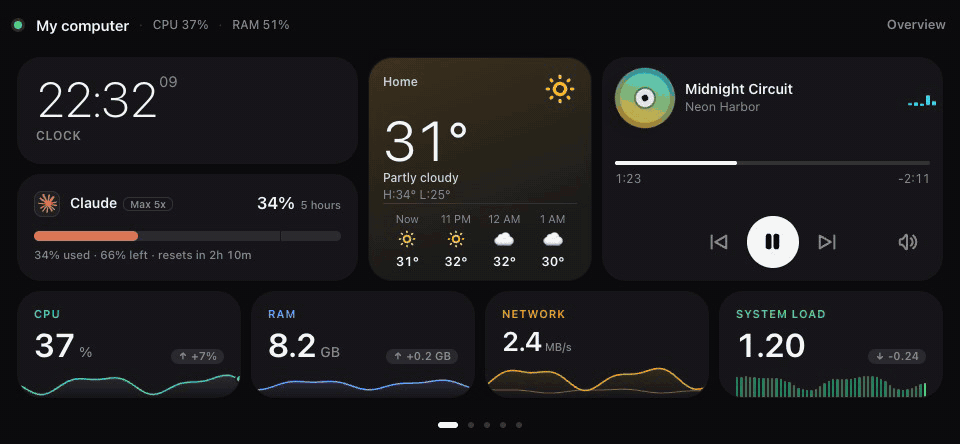
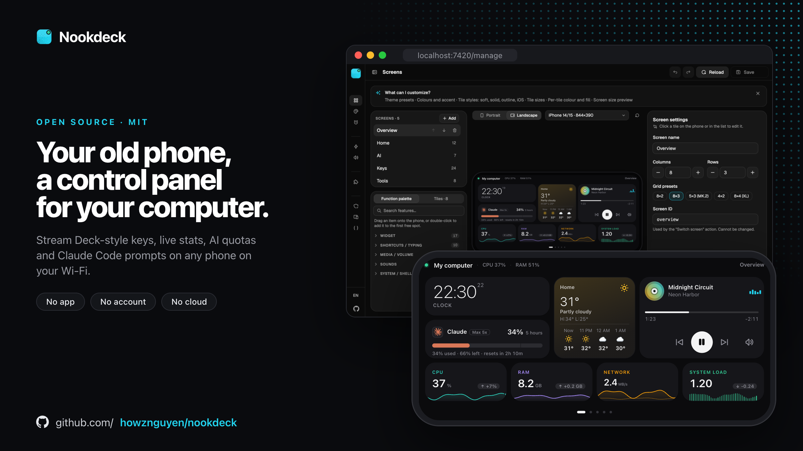
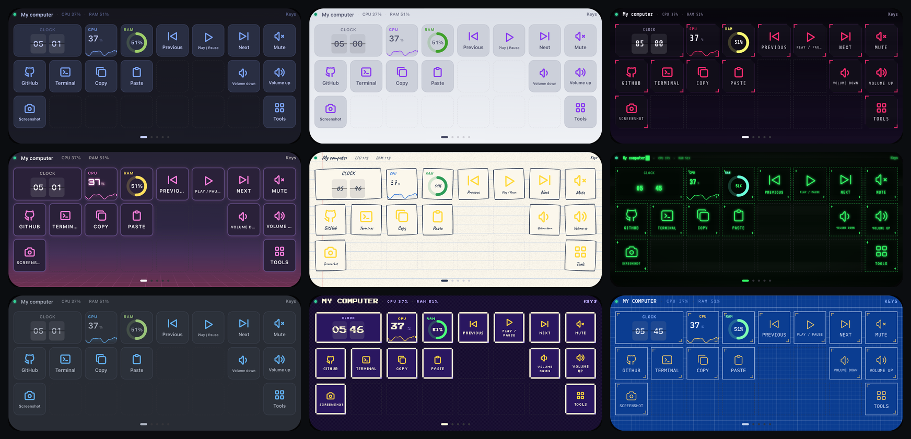
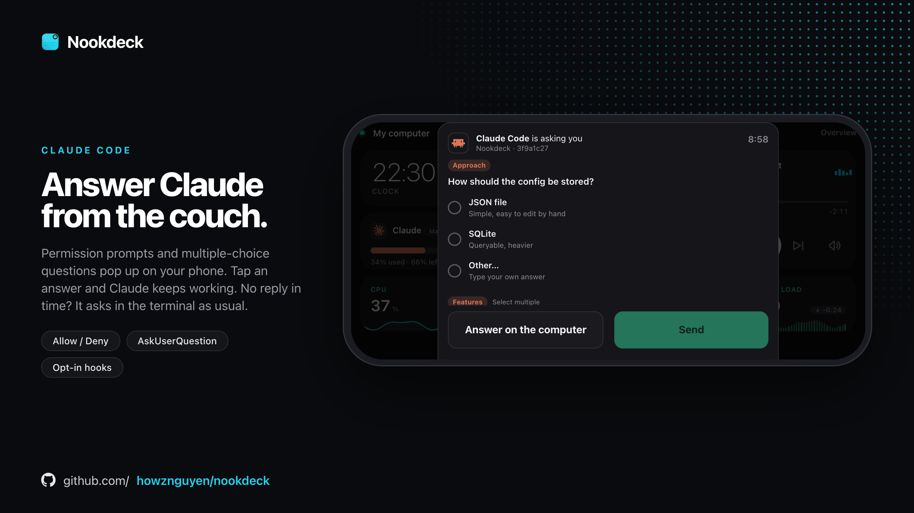
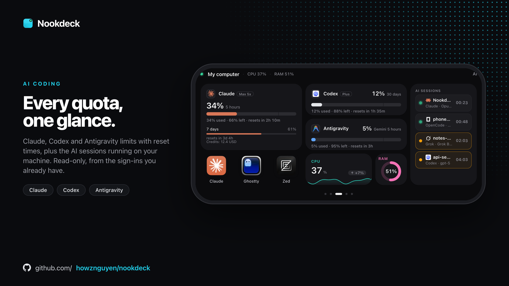
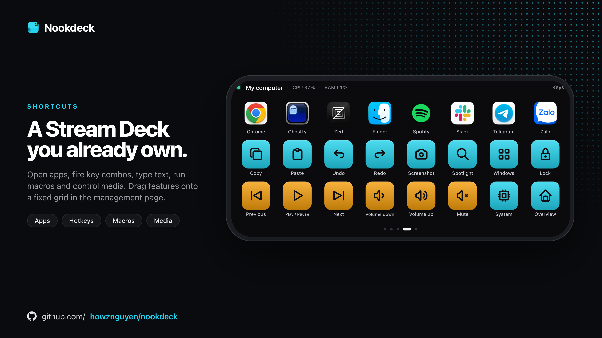
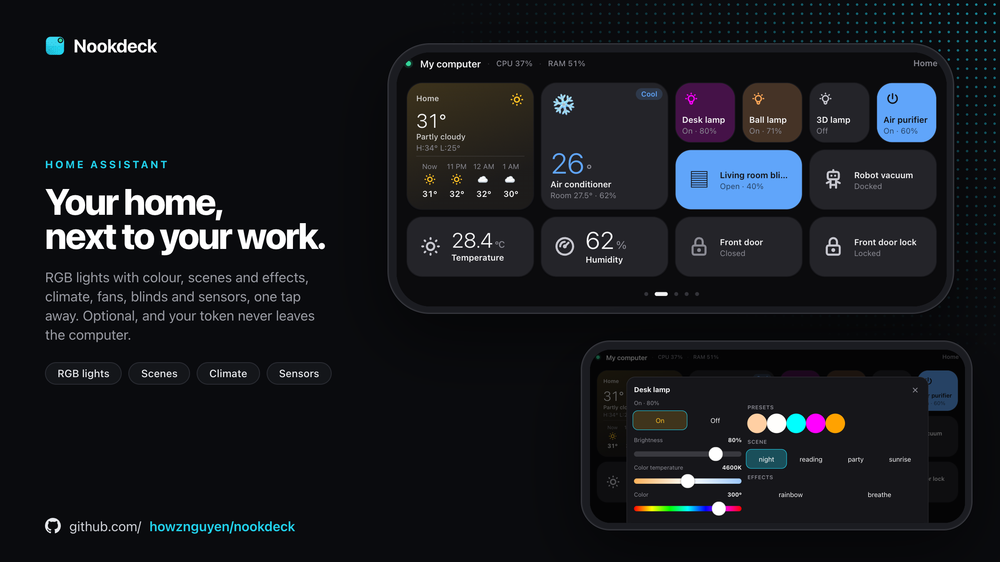
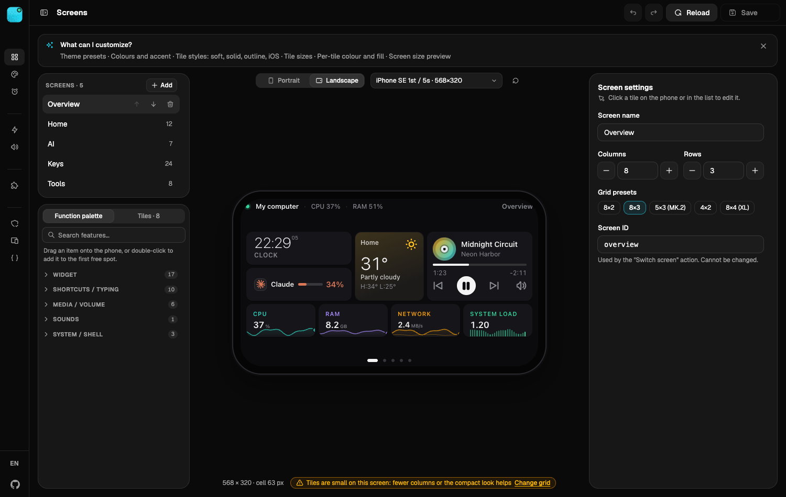
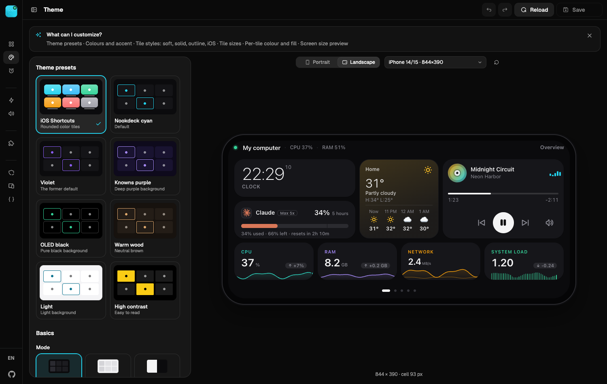
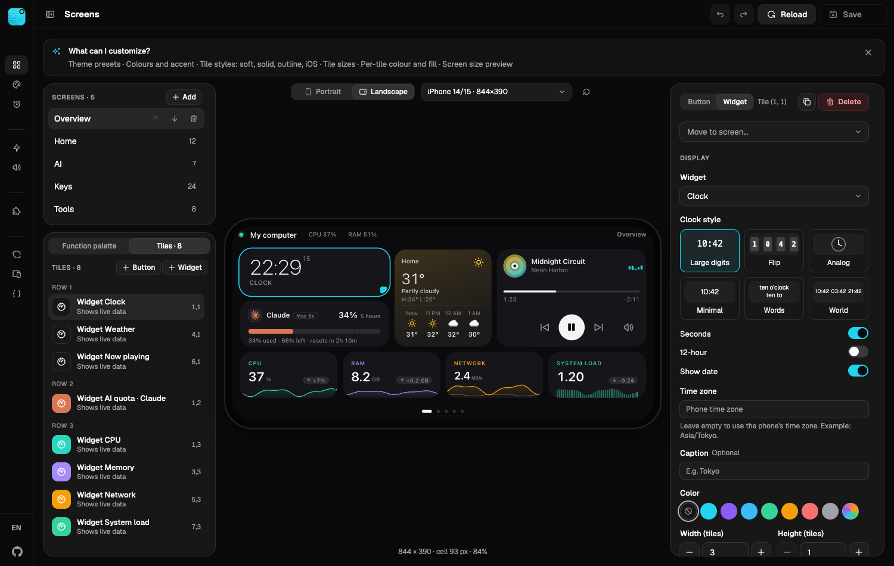

<p align="center">
  
</p>

<h1 align="center">Nookdeck</h1>

<p align="center"><b>Seu celular antigo vira um painel de controle para o computador.</b></p>

<p align="center">
  <a href="https://github.com/howznguyen/nookdeck/releases"></a>
  <a href="LICENSE"></a>
  <a href="https://github.com/howznguyen/nookdeck/stargazers"></a>
  
</p>

<p align="center"><a href="README.md">English</a> · <a href="README.vi.md">Tiếng Việt</a> · <a href="README.zh.md">中文</a> · <a href="README.fr.md">Français</a> · <b>Português</b></p>

<p align="center">
  <a href="https://github.com/howznguyen/nookdeck/releases/latest/download/Nookdeck.dmg"><b>Baixar para Mac</b></a> ·
  <a href="https://github.com/howznguyen/nookdeck/releases/latest/download/Nookdeck-Setup.exe"><b>Windows</b></a> ·
  <a href="https://github.com/howznguyen/nookdeck/releases/latest"><b>Linux</b></a> ·
  <a href="https://nookdeck.app/pt/themes"><b>Prévia dos temas ao vivo</b></a> ·
  <a href="https://nookdeck.app/pt">nookdeck.app</a>
</p>

<p align="center">
  <a href="https://macgrove.app/apps/nookdeck"></a>
</p>

Transforme um celular ou tablet antigo em um painel de controle no estilo Stream Deck e em um painel de monitoramento para o seu Mac, PC com Windows ou computador Linux.
**Ele roda no navegador do celular, então iPhone, iPad e Android funcionam, até um iPhone antigo que parou no iOS 12.**
O Nookdeck é um pequeno agente no seu computador que serve o painel de toque pelo seu Wi-Fi: nenhum app no celular, nenhuma
conta, nada de nuvem.

> **Status:** versão inicial (0.x). O foco principal é o macOS; Windows e Linux são experimentais. Os builds não são assinados com um Developer ID nem notarizados: veja [Instalação](#instalação).

<p align="center"></p>

## O que dá para fazer

| Para | No celular |
|---|---|
| **Atalhos** | Abrir apps (com os ícones de verdade) e URLs, combinações de teclas, digitar texto, comandos de shell, macros, teclas de mídia e de volume, capturas de tela (a ferramenta do sistema, ou Snapzy, CleanShot X e Shottr no Mac, ShareX e Greenshot no Windows) |
| **Monitoramento** | CPU, memória, rede, carga e tempo ligado, com estilos de gráfico à escolha; toque na CPU para ver a lista de processos |
| **Programação com IA** | Cotas do Claude, Codex e Antigravity com o horário em que zeram, para várias contas do Claude e perfis do Codex; escolha quais janelas mostrar (5 horas, 7 dias, por modelo); sessões locais do Claude Code / Codex |
| **Claude Code do sofá** | Responda aos pedidos de permissão **Permitir / Negar** e às perguntas de múltipla escolha do Claude pelo celular (hooks opcionais) |
| **On Air** | Um bloco ON AIR e um aviso em tela cheia que acendem quando o microfone ou a câmera está em uso, por um botão, por `POST /api/onair` ou enquanto o OBS transmite ou grava; os botões **Mic** e **Câmera** silenciam o microfone e ligam ou desligam a câmera no Zoom, Teams ou Google Meet |
| **Dia a dia** | Tocando agora com capa e retomar, 6 estilos de relógio e relógios mundiais, clima (por hora e por dia, °C ou °F), mesa de sons, notificações |
| **Home Assistant** | Luzes com cor, temperatura de cor, cenas e efeitos; ar-condicionado (modo, ventilação, oscilação), ventiladores, persianas, robôs aspiradores, fechaduras, sensores e imagens das câmeras (opcional) |
| **Automação** | Webhooks que enviam valores e notificações, regras que reagem à atividade no computador |
| **Do seu jeito** | Grade de arrastar e soltar (8×4, 8×3, 5×3…) com prévia para cada tamanho de tela, 4 estilos de bloco (Soft, Solid, Outline, iOS), qualquer cor em cada bloco, mais de 5.000 ícones, em inglês, vietnamita, chinês simplificado, francês ou português do Brasil |
| **Plugins** | Adicione blocos e botões (OBS, Water reminder, Stocks, Pomodoro e outros) pela [loja de plugins](https://nookdeck.app/pt/plugins) ([nookdeck-plugins](https://github.com/howznguyen/nookdeck-plugins)) ou crie os seus em TypeScript: veja o [guia de plugins](docs/plugins.md) |
| **Temas** | 15 pacotes de temas (Catppuccin, Tokyo Night, Cyberpunk, Sketchbook, Pixel…) com versões clara e escura, um modo Auto que segue o celular, fontes e fundos; [veja a prévia ao vivo](https://nookdeck.app/pt/themes) ou crie o seu |

O layout é uma grade fixa de blocos quadrados, montada arrastando e soltando na página de gerenciamento, em `http://localhost:7420/manage/`.
Um servidor MCP deixa um assistente de IA organizar o layout para você. Funciona no macOS, e no Windows 10/11 e no Linux (experimental).

## Capturas de tela

<p align="center"></p>

<p align="center"><br><sub>Alguns dos 15 pacotes de temas. <a href="https://nookdeck.app/pt/themes">Veja todos ao vivo</a>.</sub></p>

<table>
<tr>
<td width="50%"></td>
<td width="50%"></td>
</tr>
<tr>
<td align="center"><b>Responda ao Claude Code pelo celular</b></td>
<td align="center"><b>Cotas e sessões de IA</b></td>
</tr>
<tr>
<td width="50%"></td>
<td width="50%"></td>
</tr>
<tr>
<td align="center"><b>Teclas no estilo Stream Deck</b></td>
<td align="center"><b>Home Assistant</b></td>
</tr>
</table>

## Instalação

Você precisa de um **Mac** (macOS 13 ou mais recente), um **PC com Windows 10/11** ou um **computador Linux** ([experimental](docs/install.md#on-linux-experimental)), e de um **celular ou tablet no mesmo Wi-Fi**. Nada
é instalado no celular. Leva uns 2 minutos.

### 1. Instale no computador

**O app (sem precisar do Terminal)**

1. Baixe **[Nookdeck.dmg](https://github.com/howznguyen/nookdeck/releases/latest/download/Nookdeck.dmg)** (Mac) ou **[Nookdeck-Setup.exe](https://github.com/howznguyen/nookdeck/releases/latest/download/Nookdeck-Setup.exe)** (Windows).
2. **Mac:** abra o dmg, arraste o **Nookdeck** para **Aplicativos** e abra-o. **Windows:** execute o instalador (não precisa ser administrador).
3. O Nookdeck aparece na barra de menus (Mac) ou na bandeja do sistema (Windows). Clique nele e escolha **Parear um celular…** para ver o QR code e o PIN.

Na primeira vez que você abrir o app no Mac, o macOS pode dizer que não consegue verificar se ele contém software malicioso, porque o Nookdeck ainda não é assinado com um Apple Developer ID. Isso acontece uma vez só: abra **Ajustes do Sistema → Privacidade e Segurança**, role até a mensagem sobre o Nookdeck, clique em **Abrir Mesmo Assim** e confirme. No Windows, o SmartScreen pode mostrar "O Windows protegeu o computador": clique em **Mais informações → Executar assim mesmo**.

O app só controla o Nookdeck. Fechar o app não desliga o painel no celular. Passo a passo completo e ajuda: [docs/install.md](docs/install.md).

**Ou uma linha no terminal**, que faz o mesmo sem o app:

**No Mac**

1. Abra o **Terminal**: aperte <kbd>⌘ Command</kbd> + <kbd>Espaço</kbd>, digite `Terminal` e aperte <kbd>Return</kbd>.
2. Copie esta linha, cole no Terminal e aperte <kbd>Return</kbd>:

```sh
curl -fsSL https://nookdeck.app/scripts/install | bash
```

**No Windows** (experimental)

1. Abra o **PowerShell**: clique em **Iniciar**, digite `PowerShell` e aperte <kbd>Enter</kbd> (não precisa ser administrador).
2. Copie esta linha, cole no PowerShell e aperte <kbd>Enter</kbd>:

```powershell
irm https://nookdeck.app/scripts/install.ps1 | iex
```

**No Linux** (experimental)

No Ubuntu ou Debian, baixe `nookdeck_<versão>_amd64.deb` (`_arm64.deb` em ARM) da [versão mais recente](https://github.com/howznguyen/nookdeck/releases/latest) e instale a partir da pasta onde salvou:

```sh
sudo apt install ./nookdeck_*_amd64.deb
```

Depois abra o **Nookdeck** pelo menu de aplicativos. Na primeira vez, o app configura o Nookdeck para o seu usuário e coloca um ícone na bandeja. Se preferir não usar o app, a linha do Mac acima também funciona no Linux (sem `sudo`):

```sh
curl -fsSL https://nookdeck.app/scripts/install | bash
```

O que saber no Linux:

- Feito para Ubuntu 22.04 e 24.04 e Debian 12 e 13, em x86_64 ou ARM64. O Fedora (`.rpm`) é suportado na medida do possível.
- Teclas e digitação usam `xdotool` no X11. No Wayland, precisam de `ydotool` e de acesso de escrita a `/dev/uinput`: rode `nookdeck doctor`, ele mostra a correção para o seu sistema.
- O Debian com GNOME não mostra ícones na bandeja até você instalar e ativar a extensão AppIndicator (`gnome-shell-extension-appindicator`) e depois sair e entrar de novo na sessão. O Ubuntu já vem com ela ativada. Tudo também funciona pela página de gerenciamento e pelo comando `nookdeck`.
- Outras formas (`.rpm`, um tarball) e os detalhes: [docs/install.md](docs/install.md#on-linux-experimental).

Link direto, se `nookdeck.app` estiver bloqueado na sua rede: troque `https://nookdeck.app/scripts/install` por `https://raw.githubusercontent.com/howznguyen/nookdeck/main/setup.sh` (Windows: `https://raw.githubusercontent.com/howznguyen/nookdeck/main/setup.ps1`).

Você vai ver uma barra de download e depois algumas linhas `OK`. No fim, o Nookdeck mostra um **QR code**, um **endereço para o celular**
(por exemplo `http://your-mac.local:7420`) e um **PIN de 6 dígitos**. Deixe essa janela aberta para o próximo passo.

A partir de agora, o Nookdeck inicia sozinho toda vez que você entra na sua conta, e o comando `nookdeck` funciona em qualquer janela nova do terminal.

### 2. Abra no celular

- **Mais fácil:** abra a **Câmera** do celular e aponte para o QR code no computador. Toque no link que aparecer.
- **Ou** digite o endereço no navegador do celular e informe o PIN.

O celular guarda isso, então você só faz uma vez. Para ter o painel em tela cheia, adicione-o à tela inicial:

- **iPhone (Safari):** toque em **Compartilhar** → **Adicionar à Tela de Início**.
- **Android (Chrome):** toque em **⋮** → **Adicionar à tela inicial**.

### 3. Deixe do seu jeito

No computador, abra **http://localhost:7420/manage/** no navegador. Arraste apps, atalhos e widgets para a
prévia do celular e aperte **Salvar**. O celular atualiza na hora.

- **Tamanho da tela:** escolha o seu celular (iPhone 5s/SE, iPhone, Pro Max, Android, iPad ou um tamanho personalizado) acima da prévia para
  ver exatamente o que ele vai mostrar. Aparece um aviso quando os blocos ficam pequenos demais para tocar.
- **Tema:** modo, estilo dos cantos, estilo dos blocos, orientação e cor de destaque aparecem como cartões com imagem, então você vê o resultado
  antes de escolher.
- **Cada bloco:** escolha a cor, o estilo de preenchimento e o tamanho (de 1×1 até 4×3) em pequenas prévias.

<table>
<tr><td colspan="2"></td></tr>
<tr>
<td width="50%"></td>
<td width="50%"></td>
</tr>
</table>

Na primeira vez que uma tecla envia um atalho, o macOS pede a permissão de **Acessibilidade**: permita (Ajustes do Sistema →
Privacidade e Segurança → Acessibilidade). O Windows pergunta uma vez se o Nookdeck pode usar a rede: permita.

### Algo não funciona?

| Problema | O que fazer |
|---|---|
| O celular não abre o endereço | Confira se o celular e o computador estão no **mesmo Wi-Fi**. No Windows, permita o Nookdeck quando o firewall perguntar. Tente o endereço numérico que o instalador mostrou (`http://192.168…:7420`). |
| `could not reach GitHub` ou `error: 503` | O GitHub teve uma falha momentânea. Espere alguns segundos e rode a mesma linha de novo. |
| O download está lento | São uns 20 MB (40 MB no Windows). Deixe rodando; a barra mostra o andamento. |
| `nookdeck: command not found` | Abra uma janela **nova** do terminal. |
| Uma tecla não faz nada no Mac | Permita a **Acessibilidade** para o Nookdeck e rode `nookdeck doctor` para ver o que mais está faltando. |
| As teclas pararam de funcionar depois de uma atualização | O macOS vincula a Acessibilidade a cada build. Na página de gerenciamento, aba **Permissões**, aperte **Redefinir e pedir de novo** (ou rode `nookdeck doctor --request accessibility --reset`) e ative o nookdeck. |
| O endereço `.local` não abre num celular antigo | Use o endereço IP que o instalador mostrou e dê um IP fixo ao computador no roteador para que ele não mude. |
| `port 7420 is in use` | Outro programa está usando essa porta. Rode o instalador de novo com `--port 7421` (Mac: `… \| bash -s -- --port 7421`). |

### Atualizar ou remover

Vem do PhoneDesk? Nookdeck é o novo nome dele: uma atualização leva seu layout, seus celulares e suas configurações automaticamente.

- **Atualizar:** o app avisa quando sai uma versão nova, mostra o que mudou e instala. Você também pode rodar a mesma linha de instalação de novo. Seu layout e seus celulares pareados continuam.
- **Remover (Mac):** `curl -fsSL https://nookdeck.app/scripts/uninstall | bash`. Seus dados ficam; acrescente `-s -- --purge` depois de `bash` para apagá-los também.
- **Remover (Windows):** `irm https://nookdeck.app/scripts/uninstall.ps1 | iex`.
- **Remover (Linux):** a mesma linha do Mac. Se você instalou o `.deb`, rode também `sudo apt remove nookdeck`.

<details>
<summary>Mais opções e detalhes do instalador</summary>

- O instalador baixa o arquivo certo da [versão mais recente](https://github.com/howznguyen/nookdeck/releases/latest), confere
  o SHA-256 com o `SHA256SUMS` e se recusa a seguir se não bater, instala só para o seu usuário (sem `sudo`, sem
  administrador), inicia ao entrar na conta (um agente launchd no macOS, uma tarefa do Agendador de Tarefas no Windows, um serviço de usuário do systemd no Linux) e o adiciona ao seu PATH.
- As opções no Mac vão depois de `bash -s --`: `--yes` (sem perguntas), `--version 0.1.1`, `--port 7421`, `--no-autostart`,
  `--no-open`, `--no-path`, `--dry-run`. No Windows, defina variáveis de ambiente antes da linha, por exemplo
  `$env:NOOKDECK_PORT=7421; irm … | iex` (veja o começo do [setup.ps1](setup.ps1)).
- Arquivos: o programa fica em `~/.nookdeck/bin/nookdeck` no macOS e no Linux, e em `%LOCALAPPDATA%\Nookdeck\bin\nookdeck.exe` no
  Windows; seus dados ficam em `~/.nookdeck`; os logs em `~/.nookdeck/logs`.
- Serviço em segundo plano: `nookdeck service install|uninstall|status|restart`.
- Assinatura: os binários são assinados ad hoc, não com um Apple Developer ID nem com um certificado do Windows. Os instaladores
  cuidam disso; um arquivo baixado pelo navegador pode precisar de `xattr -d com.apple.quarantine <file>` no macOS ou de "Mais informações →
  Executar assim mesmo" no Windows SmartScreen.
- Problema conhecido no Windows: teclas que digitam texto podem gerar caracteres errados. Abrir apps, atalhos, mídia e volume funcionam.

</details>

## Plugins

- **Loja:** na página de gerenciamento, abra **Plugins** → **Descobrir**, ou navegue em [nookdeck.app/pt/plugins](https://nookdeck.app/pt/plugins) e aperte **Abrir no Nookdeck**. Todo plugin da lista é revisado e fixado nos seus arquivos ([nookdeck-plugins](https://github.com/howznguyen/nookdeck-plugins)).
- **Do GitHub:** cole o link de um repositório ou de uma pasta em **Plugins** → **Instalar de um link**. Plugins fora da lista aparecem como Não revisado.
- **Crie um:** um `nookdeck.json` para blocos e botões simples, ou TypeScript com o SDK `@nookdeck/plugin`. Comece com `nookdeck plugin new`, veja o [guia de plugins](docs/plugins.md) e abra um pull request em [nookdeck-plugins](https://github.com/howznguyen/nookdeck-plugins) para entrar na lista.

## Temas

- **Escolha um visual:** na página de gerenciamento, abra **Tema** → **Pacotes**. Catppuccin, Tokyo Night, Night Owl, One Dark Pro, JellyFish, SynthWave '84 e Cyberpunk estão na loja, ao lado dos visuais do Nookdeck que já vêm instalados. Cada pacote tem variantes (como Latte e Mocha) e um modo **Auto** para claro e escuro. Escolha um, aperte **Aplicar** e desfaça se não gostar.
- **Crie o seu:** monte o visual em **Tema** → **Personalizar**, aperte **Exportar esta aparência**, edite os arquivos e instale de novo. Temas são dados e CSS e não executam código. Veja o [guia de temas](docs/themes.md).
- **Compartilhe:** abra um pull request em [nookdeck-plugins](https://github.com/howznguyen/nookdeck-plugins) (`themes/`) para entrar na lista.

## Instalar a partir do código-fonte

Requisitos: macOS 13+ (Apple silicon ou Intel), Windows 10/11 x64 (experimental) ou Linux x86_64/ARM64 (experimental).

A partir do código-fonte (precisa do [Bun](https://bun.sh) 1.3+):

```sh
git clone https://github.com/howznguyen/nookdeck && cd nookdeck
bun install
bun run build          # gera os apps web e o dist/nookdeck
./dist/nookdeck       # mostra a URL para o celular e um PIN de pareamento
```

No Windows, `bun run build:win` gera `dist/nookdeck-windows-x64.exe`.

Abra a URL mostrada no celular (mesmo Wi-Fi), informe o PIN e adicione a página à tela inicial para ter um
painel em tela cheia. A página de gerenciamento fica em `http://localhost:7420/manage/` no Mac.

O macOS pede a permissão de **Acessibilidade** na primeira vez que um bloco envia teclas.

## Integração com o Claude Code (opcional)

Na página de gerenciamento, seção **AI**, dois interruptores separados instalam hooks em `~/.claude/settings.json` (antes é feito um backup):

- **Pedidos de permissão**: um hook `PermissionRequest` mostra Permitir / Negar no celular.
- **Perguntas**: um hook `PreToolUse` para `AskUserQuestion` mostra as opções do Claude no celular e devolve a sua
  escolha. Se quiser, só enquanto você estiver longe do teclado.

Se nenhum celular responder a tempo, o Claude Code pergunta no terminal como de costume. No Codex, o hook de permissão vai em
`~/.codex/hooks.json`.

As cotas são só leitura: o Nookdeck lê o login que o Claude Code já salvou (sem nunca renová-lo), os arquivos de sessão
locais do Codex e o servidor local do Antigravity. Veja o [PRIVACY.md](PRIVACY.md) para cada conexão de saída. O app não envia telemetria; só o instalador e o site contam instalações (de forma anônima; para desativar, use `NOOKDECK_NO_ANALYTICS=1`; veja [Estatísticas de instalação](PRIVACY.md#install-statistics-website-and-installer)).

## Permissões

O macOS vincula cada permissão ao programa que a pede. Com o serviço em segundo plano, esse programa é o binário `nookdeck`; iniciado por um terminal, é o app do terminal. Rode `nookdeck doctor` para ver o que foi concedido (ele pergunta ao agente em execução e nunca mostra um pedido por conta própria):

| Permissão | Necessária para | Onde |
|---|---|---|
| Acessibilidade | blocos de teclas, de digitação e de volume | Privacidade e Segurança > Acessibilidade |
| Automação: System Events, Música, Spotify | blocos de teclas, Tocando agora e teclas de mídia | Privacidade e Segurança > Automação |
| Chaves: Claude Code | cota de uso do Claude (só leitura) | o macOS pergunta uma vez: escolha Sempre Permitir |
| Rede Local | Home Assistant na sua rede local | Privacidade e Segurança > Rede Local |
| Firewall | celulares se conectando ao agente | Rede > Firewall > Opções |

```bash
nookdeck doctor                          # ✓ / ✗ para cada item, com a correção
nookdeck doctor --open accessibility     # abre o painel certo dos Ajustes
nookdeck doctor --request accessibility  # faz o macOS listar o nookdeck (mostra o pedido dele)
```

As atualizações são assinadas ad hoc, então o macOS pode pedir de novo depois de uma atualização: remova a entrada antiga do `nookdeck` da lista de Privacidade e adicione de novo. Isso deixa de acontecer quando as versões forem assinadas com um Developer ID.

**No Windows**, o `nookdeck doctor` verifica outras coisas (mesmos comandos; `nookdeck doctor --open firewall` abre a Segurança do Windows):

| Verificação | Por que importa |
|---|---|
| Firewall | O Windows bloqueia conexões de entrada a menos que uma regra permita o `nookdeck.exe`; o instalador oferece uma regra, só para a sua sub-rede local (um pedido do UAC, removida pelo `uninstall.ps1`). Manualmente, como administrador: `netsh advfirewall firewall add rule name="Nookdeck" dir=in action=allow program="<path>\nookdeck.exe" profile=any remoteip=localsubnet` |
| Perfil de rede | Seu Wi-Fi ou Ethernet deve ser uma rede Privada (Configurações > Rede e Internet) |
| Sessão da área de trabalho | Teclas, digitação, Tocando agora e volume só funcionam quando o Nookdeck roda na sua sessão de área de trabalho conectada (a tarefa agendada roda assim; uma sessão SSH ou um serviço do Windows, não) |
| Auxiliar do PowerShell | Tocando agora, volume, ícones de apps e a lista de processos usam um pequeno auxiliar do Windows PowerShell 5.1 |
| SmartScreen | Um `nookdeck.exe` baixado que leva a marca da internet gera avisos; o instalador remove essa marca |

**No Linux** (experimental) não há pedidos de permissão. O `nookdeck doctor` verifica as ferramentas que o Nookdeck usa e mostra o comando que corrige cada uma; ele nunca altera o seu sistema por conta própria:

| Verificação | Por que importa |
|---|---|
| Serviço | O Nookdeck roda como serviço de usuário do systemd (`nookdeck service status`, logs em `~/.nookdeck/logs`), ou por uma entrada de inicialização automática onde não há sessão de usuário do systemd |
| Teclas e digitação | X11: `xdotool`. Wayland: `ydotool` (a versão 1.x também precisa do `ydotoold` rodando) e acesso de escrita a `/dev/uinput`, pelo grupo `input` ou por uma regra do udev |
| Mídia e volume | Tocando agora usa `playerctl`, o volume usa `pactl` (`pulseaudio-utils`, funciona também com PipeWire) |
| Firewall | Com o `ufw` ativo, o celular não consegue se conectar até a porta ser liberada: o doctor mostra a linha `sudo ufw allow` |

## Assistente de layout com IA (MCP)

O Nookdeck vem com um servidor MCP, então o Claude Code (ou qualquer cliente MCP) pode organizar o seu painel com linguagem comum: "adicione uma página com minhas ferramentas de dev", "coloque o Spotify ao lado do relógio". Ele conversa com o agente em execução, então inicie o Nookdeck antes.

Registre uma vez, com o caminho que o instalador usou:

| Instalado com | Comando |
|---|---|
| `setup.sh` (macOS, Linux) | `claude mcp add nookdeck -- ~/.nookdeck/bin/nookdeck mcp` |
| `setup.ps1` (Windows) | `claude mcp add nookdeck -- "%LOCALAPPDATA%\Nookdeck\bin\nookdeck.exe" mcp` |
| Compilado do código-fonte | `claude mcp add nookdeck -- /caminho/completo/para/dist/nookdeck mcp` |

Acrescente `--port N` depois de `mcp` se o agente não usar a porta 7420, e `--scope user` antes de `nookdeck` para deixá-lo disponível em todos os projetos. Confira com `claude mcp list`.

Ferramentas: `get_layout`, `add_page`, `add_item`, `update_item`, `move_item`, `resize_item`, `remove_item`, `update_page`, `remove_page`, `set_theme`, `list_apps`, `list_widgets`, `search_icons`, `preview_changes`, `undo`. Toda mudança passa pela mesma validação da página de gerenciamento e pode ser desfeita. A [skill de layout](docs/skills/nookdeck-layout/SKILL.md) descreve o esquema para o assistente.

## Segurança

- O agente escuta na sua rede local. Os celulares precisam ser pareados com um PIN de 6 dígitos; o token do aparelho fica guardado em um cookie.
- A API de gerenciamento só responde em `localhost` e recusa requisições de outros sites e de DNS rebinding.
- Os blocos podem rodar comandos de shell que você configurar. Só pareie aparelhos em que você confia.

## Desenvolvimento

```sh
bun run dev     # agente com modo watch
bun run test    # testes unitários
```

Estrutura: `src/` o agente (Bun + TypeScript), `web/deck` a interface do celular (Preact, Safari 12+), `web/manage` a página de gerenciamento
(React), `web/shared` o código usado pelos dois.

## Como contribuir

Pull requests, relatos de bugs e traduções são bem-vindos. Leia o [CONTRIBUTING.md](CONTRIBUTING.md) (em inglês) para o ambiente de desenvolvimento, a estrutura do projeto e as regras que um pull request precisa seguir.

```sh
bun install
bun test
bun run build
```

Bugs e ideias vão para as [issues do GitHub](https://github.com/howznguyen/nookdeck/issues). Vulnerabilidades: por favor, informe em particular; veja [Security](CONTRIBUTING.md#security).

### Quem contribuiu

<a href="https://github.com/howznguyen/nookdeck/graphs/contributors"></a>

Obrigado a:

- [Ron Ng (ronnhd)](https://github.com/ronnhd): capas de vinil e correções nas capas do Tocando agora.
- [Howie989](https://github.com/Howie989): tradução para chinês simplificado.

## Apoie

O Nookdeck é gratuito e feito no meu tempo livre. Se ele for útil para você:

- **Dê uma estrela no repositório** no GitHub: isso ajuda outras pessoas a encontrar o Nookdeck.
- **Me pague um café** no [Ko-fi](https://ko-fi.com/howznguyen).
- **Conte para um amigo**, ou [compartilhe um plugin ou tema](https://github.com/howznguyen/nookdeck-plugins).

<p><a href="https://ko-fi.com/howznguyen"></a> <a href="https://github.com/howznguyen/nookdeck/stargazers"></a></p>

## Créditos

- Ícones: [Tabler Icons](https://tabler.io/icons) (MIT) e [LobeHub Icons](https://github.com/lobehub/lobe-icons) (MIT).
- Componentes de interface: [Knowns UI](https://ui.knowns.dev).
- Dados do clima: [Open-Meteo](https://open-meteo.com) (CC BY 4.0).

## Autor

[howznguyen](https://github.com/howznguyen) | Vietnamita

## Licença

[MIT](LICENSE)
