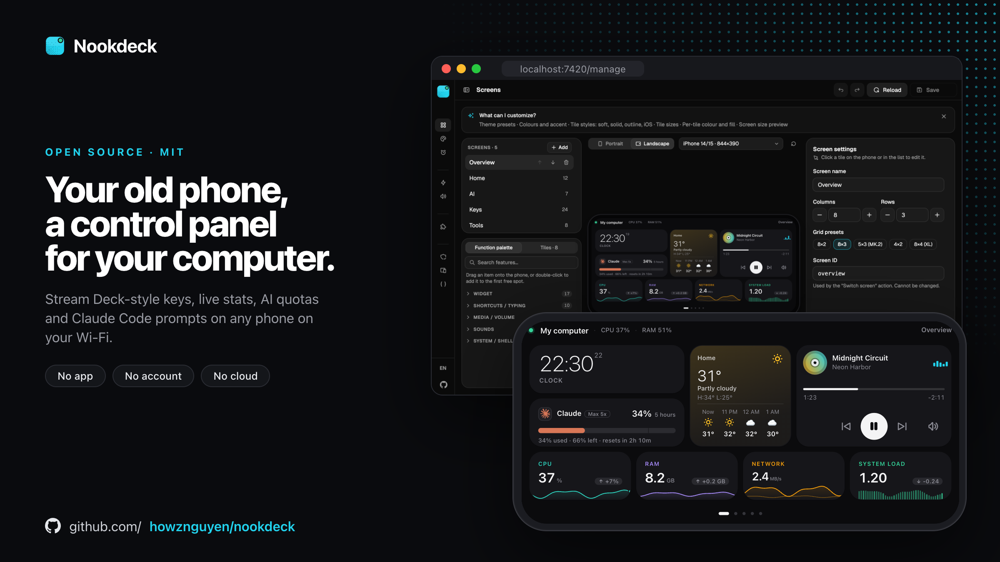
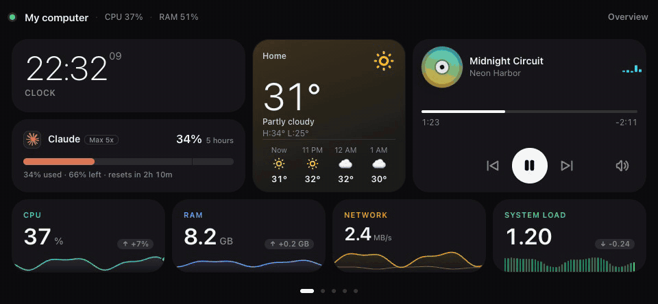
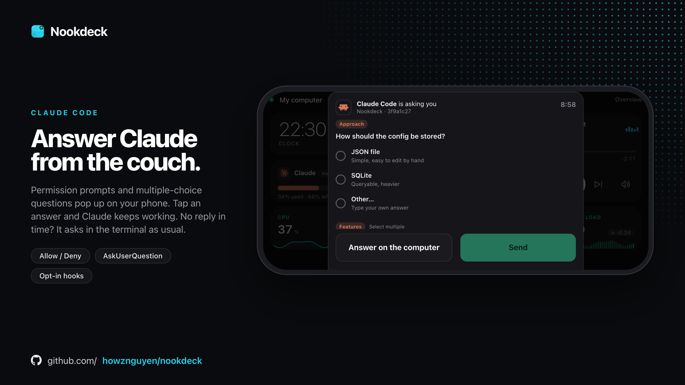
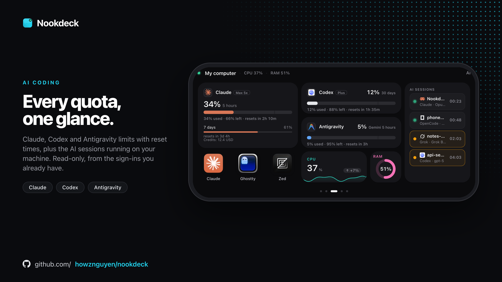
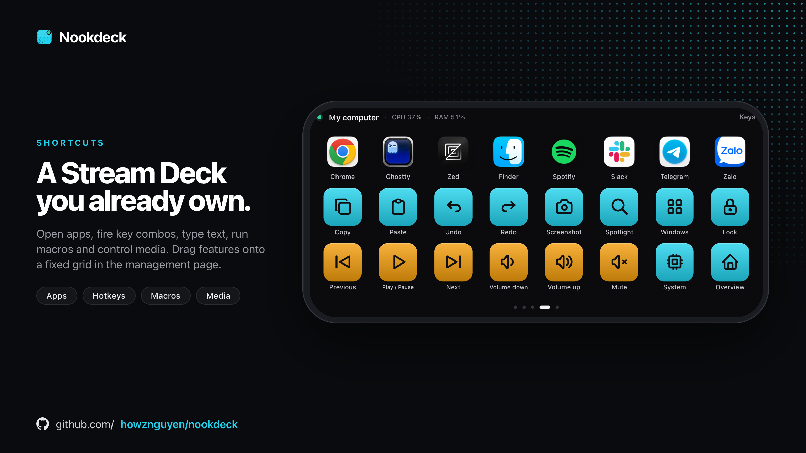
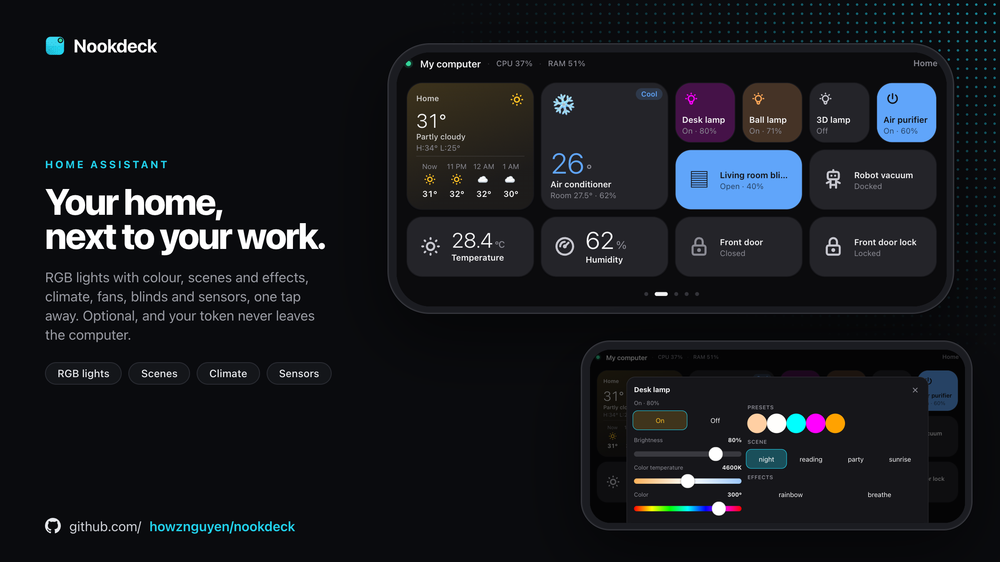
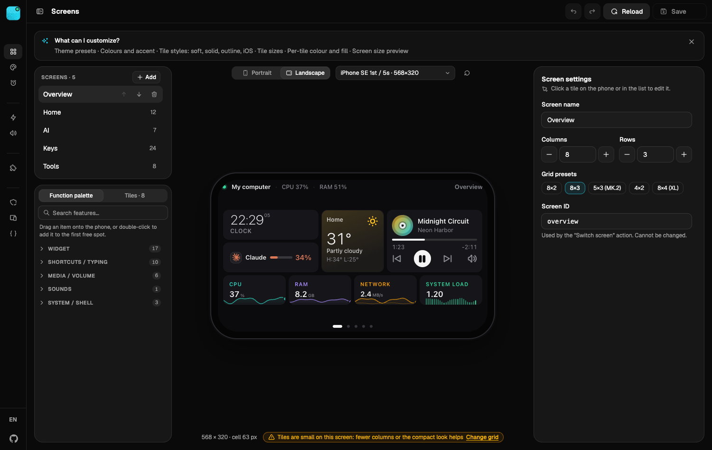
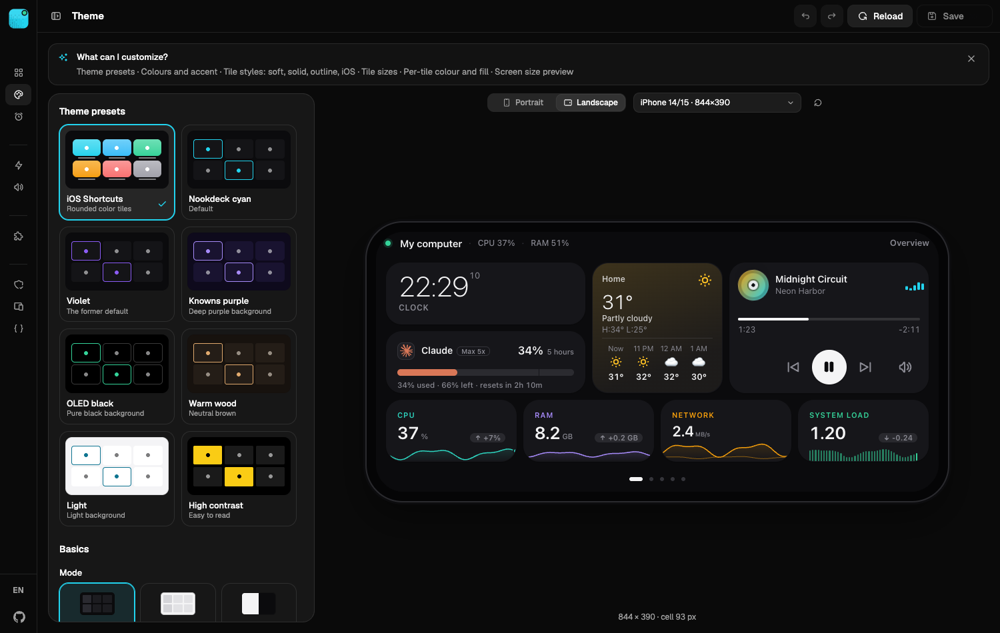
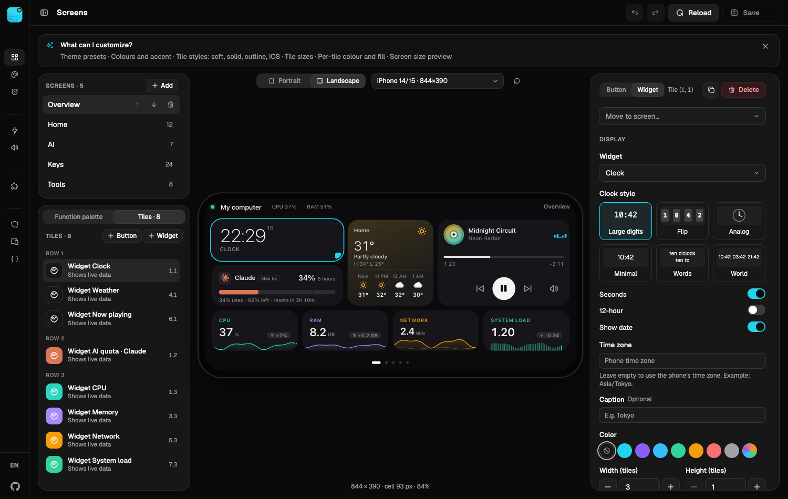

<p align="center">
  
</p>

<h1 align="center">Nookdeck</h1>

<p align="center"><b>把旧手机变成电脑的控制面板。</b></p>

<p align="center"><sub>原名 PhoneDesk。已有安装在更新时会自动迁移。</sub></p>

<p align="center">
  <a href="https://github.com/howznguyen/nookdeck/releases"></a>
  <a href="LICENSE"></a>
  
</p>

<p align="center"><a href="README.md">English</a> · <a href="README.vi.md">Tiếng Việt</a> · <b>中文</b></p>

<p align="center"><a href="https://nookdeck.app">nookdeck.app</a></p>

把旧手机或平板变成 Stream Deck 风格的控制面板和仪表盘，用来控制你的 Mac 或 Windows 电脑。Nookdeck 是一个运行在电脑上的小型
agent，向同一 Wi-Fi 下的任意浏览器提供触控界面。手机上无需安装 app，也不需要账号或云服务。

> **状态：** 早期版本（0.x）。macOS 是主要目标平台，Windows 为实验性支持。安装包没有使用 Developer ID 签名，也没有经过公证：见[安装](#安装)。

<p align="center"></p>

## 你可以做什么

| 用途 | 在手机上 |
|---|---|
| **快捷操作** | 打开 app（显示真实图标）和 URL、组合键、输入文字、shell 命令、宏、媒体键和音量键 |
| **监控** | CPU、内存、网络、负载和运行时间，可选择图表样式；点击 CPU 查看进程列表 |
| **AI 编程** | Claude、Codex 和 Antigravity 的额度与重置时间；可选择要显示的时间窗口（5 小时、7 天、按模型）；本机的 Claude Code / Codex 会话 |
| **在沙发上用 Claude Code** | 在手机上回答**允许 / 拒绝**权限请求和 Claude 的选择题（需手动开启 hook） |
| **日常** | 带封面和继续播放的正在播放、6 种时钟样式和世界时钟、天气（逐小时和逐日，°C 或 °F）、音效板、通知 |
| **Home Assistant** | 支持颜色、色温、场景和效果的灯；空调（模式、风速、摆风）、风扇、窗帘、扫地机器人、门锁和传感器（可选） |
| **自动化** | 推送数值和通知的 Webhook，以及根据电脑上的活动触发的规则 |
| **个性化** | 可拖放的网格（8×4、8×3、5×3…），可按每种屏幕尺寸预览，4 种磁贴样式（Soft、Solid、Outline、iOS），每个磁贴可设任意颜色，5,000+ 图标，English、Vietnamese 和 Chinese |
| **插件** | 从[插件商店](https://nookdeck.app/plugins)（[nookdeck-plugins](https://github.com/howznguyen/nookdeck-plugins)）添加磁贴和按钮，或用 TypeScript 自己开发：参阅[插件指南](docs/plugins.md) |

布局是由方形磁贴组成的固定网格，在 `http://localhost:7420/manage/` 的拖放式管理页面中编排。MCP 服务器可以让 AI 助手帮你排布局。
支持 macOS，以及 Windows 10/11（实验性）。

## 截图

<p align="center"><br><sub>16 秒演示（演示数据）：页面、AI 额度、按键、Home Assistant 和一个 Claude Code 提问。</sub></p>

<table>
<tr>
<td width="50%"></td>
<td width="50%"></td>
</tr>
<tr>
<td align="center"><b>在手机上回答 Claude Code</b></td>
<td align="center"><b>AI 额度与会话</b></td>
</tr>
<tr>
<td width="50%"></td>
<td width="50%"></td>
</tr>
<tr>
<td align="center"><b>Stream Deck 风格的按键</b></td>
<td align="center"><b>Home Assistant</b></td>
</tr>
</table>

## 安装

你需要一台 **Mac**（macOS 13 或更高版本）或 **Windows 10/11 电脑**，以及一台连接**同一 Wi-Fi 的手机或平板**。手机上不需要安装任何东西。大约需要 2 分钟。

### 1. 在电脑上安装

**应用（无需终端）**

1. 下载 **[Nookdeck.dmg](https://github.com/howznguyen/nookdeck/releases/latest/download/Nookdeck.dmg)**（Mac）或 **[Nookdeck-Setup.exe](https://github.com/howznguyen/nookdeck/releases/latest/download/Nookdeck-Setup.exe)**（Windows）。
2. **Mac：** 打开 dmg，把 **Nookdeck** 拖到 **应用程序** 文件夹，然后打开它。**Windows：** 运行安装程序（无需管理员权限）。
3. Nookdeck 会出现在菜单栏（Mac）或系统托盘（Windows）。点击它并选择 **配对新手机…**，即可看到二维码和 PIN 码。

第一次打开 Mac 应用时，macOS 可能提示无法检查其中是否含有恶意软件，因为 Nookdeck 暂时还没有 Apple Developer ID 签名。这只需操作一次：打开 **系统设置 → 隐私与安全性**，向下找到关于 Nookdeck 的提示，点击 **仍要打开**（Open Anyway）并确认。在 Windows 上，SmartScreen 可能显示“Windows 已保护你的电脑”：点击 **更多信息 → 仍要运行**。

应用只负责控制 Nookdeck。退出应用不会让手机面板停止工作。完整步骤和帮助：[docs/install.md](docs/install.md)。

**或者在终端中运行一行命令**，效果相同，不需要应用：

**在 Mac 上**

1. 打开**终端**：按 <kbd>⌘ Command</kbd> + <kbd>Space</kbd>，输入 `Terminal`，按 <kbd>Return</kbd>。
2. 复制下面这行，粘贴到终端，按 <kbd>Return</kbd>：

```sh
curl -fsSL https://nookdeck.app/scripts/install | bash
```

**在 Windows 上**（实验性）

1. 打开 **PowerShell**：点击**开始**，输入 `PowerShell`，按 <kbd>Enter</kbd>（无需管理员权限）。
2. 复制下面这行，粘贴到 PowerShell，按 <kbd>Enter</kbd>：

```powershell
irm https://nookdeck.app/scripts/install.ps1 | iex
```

直接链接，如果你的网络无法访问 `nookdeck.app`：把 `https://nookdeck.app/scripts/install` 换成 `https://raw.githubusercontent.com/howznguyen/nookdeck/main/setup.sh`（Windows：`https://raw.githubusercontent.com/howznguyen/nookdeck/main/setup.ps1`）。

你会看到下载进度条，然后是几行 `OK`。最后 Nookdeck 会显示一个**二维码**、一个**手机地址**
（例如 `http://your-mac.local:7420`）和一个**6 位 PIN**。请保持这个窗口打开，进行下一步。

之后每次登录时 Nookdeck 都会自动启动，`nookdeck` 命令在任何新终端窗口中都可用。

### 2. 在手机上打开

- **最简单：** 打开手机**相机**，对准电脑上的二维码，点击出现的链接。
- **或者**在手机浏览器中输入手机地址，并输入 PIN。

手机会记住它，所以只需操作一次。想要全屏面板，把它添加到主屏幕：

- **iPhone（Safari）：** 点击**分享** → **添加到主屏幕**。
- **Android（Chrome）：** 点击 **⋮** → **添加到主屏幕**。

### 3. 个性化

在电脑上用浏览器打开 **http://localhost:7420/manage/**。把 app、快捷操作和小组件拖到手机预览上，然后点击**保存**。手机会立即更新。

- **屏幕尺寸：** 在预览上方选择你的手机（iPhone 5s/SE、iPhone、Pro Max、Android、iPad 或自定义尺寸），准确查看它会显示的效果。磁贴小到难以点按时会出现警告。
- **主题：** 模式、圆角样式、磁贴样式、方向和强调色都是图片卡片，选择前就能看到效果。
- **每个磁贴：** 从小预览中选择颜色、填充样式和尺寸（1×1 到 4×3）。

<table>
<tr><td colspan="2"></td></tr>
<tr>
<td width="50%"></td>
<td width="50%"></td>
</tr>
</table>

按键第一次发送快捷键时，macOS 会请求**辅助功能**权限：请允许（系统设置 →
隐私与安全性 → 辅助功能）。Windows 会询问一次是否允许 Nookdeck 访问网络：请允许。

### 遇到问题？

| 问题 | 解决办法 |
|---|---|
| 手机打不开地址 | 确认手机和电脑在**同一 Wi-Fi** 下。在 Windows 上，请在防火墙提示中允许 Nookdeck。试试安装程序打印出的数字地址（`http://192.168…:7420`）。 |
| `could not reach GitHub` 或 `error: 503` | GitHub 暂时出了问题。等几秒钟，再运行同一行命令。 |
| 下载很慢 | 大约 20 MB（Windows 为 40 MB）。让它继续运行，进度条会显示进度。 |
| `nookdeck: command not found` | 打开一个**新的**终端窗口。 |
| Mac 上某个按键没反应 | 为 Nookdeck 允许**辅助功能**，然后运行 `nookdeck doctor` 查看还缺什么。 |
| 更新后按键失效 | macOS 会把辅助功能权限绑定到每个构建版本。在管理页面的**权限**标签页，点击**重置并重新请求**（或运行 `nookdeck doctor --request accessibility --reset`），然后打开 nookdeck。 |
| 旧手机打不开 `.local` 地址 | 使用安装程序打印的 IP 地址，并在路由器中给电脑分配固定 IP，避免它变化。 |
| `port 7420 is in use` | 另一个程序占用了该端口。用 `--port 7421` 重新运行安装程序（Mac：`… \| bash -s -- --port 7421`）。 |

### 更新或卸载

- **更新：** 再运行一遍同样的安装命令。你的布局和已配对的手机会保留。
- **卸载（Mac）：** `curl -fsSL https://nookdeck.app/scripts/uninstall | bash`。数据会保留；在 `bash` 后加上 `-s -- --purge` 可一并删除。
- **卸载（Windows）：** `irm https://nookdeck.app/scripts/uninstall.ps1 | iex`。

<details>
<summary>更多安装选项和细节</summary>

- 安装程序会从[最新发布版](https://github.com/howznguyen/nookdeck/releases/latest)下载对应文件，用 `SHA256SUMS` 校验其 SHA-256，不一致就拒绝安装；只为当前用户安装（不需要 `sudo` 或管理员权限），登录时自动启动（macOS 使用 launchd agent，Windows 使用任务计划程序任务），并加入你的 PATH。
- Mac 选项写在 `bash -s --` 之后：`--yes`（不提问）、`--version 0.1.1`、`--port 7421`、`--no-autostart`、`--no-open`、`--no-path`、`--dry-run`。在 Windows 上，在命令前设置环境变量，例如 `$env:NOOKDECK_PORT=7421; irm … | iex`（见 [setup.ps1](setup.ps1) 顶部）。
- 文件：程序在 macOS 上是 `~/.nookdeck/bin/nookdeck`，在 Windows 上是 `%LOCALAPPDATA%\Nookdeck\bin\nookdeck.exe`；数据在 `~/.nookdeck`；日志在 `~/.nookdeck/logs`。
- 后台服务：`nookdeck service install|uninstall|status|restart`。
- 签名：二进制文件使用临时签名（ad hoc），没有 Apple Developer ID 或 Windows 证书。安装程序会处理这一点；用浏览器下载的文件在 macOS 上可能需要 `xattr -d com.apple.quarantine <file>`，在 Windows SmartScreen 中需要点击「更多信息 → 仍要运行」。
- Windows 已知问题：输入文字的按键可能产生错误字符。打开 app、快捷键、媒体和音量功能正常。

</details>

## 插件

- **商店:** 在管理页面打开 **Plugins** → **Discover**,或访问 [nookdeck.app/plugins](https://nookdeck.app/plugins) 并点击 **Open in Nookdeck**。列表中的插件都经过审核,并按文件固定版本([nookdeck-plugins](https://github.com/howznguyen/nookdeck-plugins))。
- **从 GitHub 安装:** 在 **Plugins** → **Install from a link** 粘贴仓库或文件夹链接。未收录的插件标记为 Unreviewed。
- **自己开发:** 简单的磁贴和按钮只需一个 `nookdeck.json`,也可以用 `@nookdeck/plugin` SDK 写 TypeScript。用 `nookdeck plugin new` 开始,参阅[插件指南](docs/plugins.md),然后向 [nookdeck-plugins](https://github.com/howznguyen/nookdeck-plugins) 提交 pull request 即可收录。

## 主题

- **选择外观：** 在管理页面打开 **主题** → **主题包**。Catppuccin、Tokyo Night、Night Owl、One Dark Pro、JellyFish、SynthWave '84 和 Cyberpunk 都在商店里，还有内置的 Nookdeck 外观。每个主题包都有多个变体（如 Latte 和 Mocha），以及随浅色/深色自动切换的 **自动** 模式。选一个，点击 **应用**，不喜欢可以撤销。
- **自己做：** 在 **主题** → **自定义** 里调好外观，点击 **导出此外观**，编辑文件后再安装。主题只是数据和 CSS，不能运行代码。详见[主题指南](docs/themes.md)。
- **分享：** 向 [nookdeck-plugins](https://github.com/howznguyen/nookdeck-plugins) 的 `themes/` 目录提交 pull request，即可被收录。

## 从源码安装

要求：macOS 13+（Apple silicon 或 Intel），或 Windows 10/11 x64（实验性）。Linux 尚未测试。

从源码构建（需要 [Bun](https://bun.sh) 1.3+）：

```sh
git clone https://github.com/howznguyen/nookdeck && cd nookdeck
bun install
bun run build          # 构建 web 应用和 dist/nookdeck
./dist/nookdeck       # 打印手机 URL 和配对 PIN
```

在 Windows 上，`bun run build:win` 会生成 `dist/nookdeck-windows-x64.exe`。

在手机上（同一 Wi-Fi）打开打印出的 URL，输入 PIN，并把页面添加到主屏幕以获得全屏面板。管理页面在 Mac 上的地址是 `http://localhost:7420/manage/`。

macOS 会在磁贴第一次发送按键时请求**辅助功能**权限。

## Claude Code 集成（可选）

在 **Manage › AI** 中，两个独立的开关会把 hook 安装到 `~/.claude/settings.json`（会先写入备份）：

- **权限请求：** `PermissionRequest` hook 在手机上显示允许 / 拒绝。
- **提问：** 针对 `AskUserQuestion` 的 `PreToolUse` hook 在手机上显示 Claude 的选项，并返回你的选择。也可以设为仅在你离开键盘时启用。

如果手机没有及时回应，Claude Code 会照常在终端中询问。对于 Codex，权限 hook 写入 `~/.codex/hooks.json`。

额度是只读的：Nookdeck 读取 Claude Code 已保存的登录凭据（从不刷新它）、Codex 的本地会话文件以及 Antigravity 的本地服务器。所有对外连接见 [PRIVACY.md](PRIVACY.md)。应用本身不发送遥测数据；只有安装程序和网站会统计安装次数（匿名，可用 `NOOKDECK_NO_ANALYTICS=1` 关闭，见[安装统计](PRIVACY.md#install-statistics-website-and-installer)）。

## 权限

macOS 把每项权限绑定到发起请求的程序。在后台服务下，这个程序是 `nookdeck` 二进制文件；从终端启动时则是终端 app。运行 `nookdeck doctor` 查看已授予哪些权限（它会询问正在运行的 agent，自己不会弹出任何提示）：

| 权限 | 用于 | 位置 |
|---|---|---|
| 辅助功能 | 按键、输入文字和音量磁贴 | 隐私与安全性 > 辅助功能 |
| 自动化：System Events、Music、Spotify | 按键磁贴、正在播放和媒体键 | 隐私与安全性 > 自动化 |
| 钥匙串：Claude Code | Claude 使用额度（只读） | macOS 会询问一次：选择始终允许 |
| 本地网络 | 局域网中的 Home Assistant | 隐私与安全性 > 本地网络 |
| 防火墙 | 手机连接到 agent | 网络 > 防火墙 > 选项 |

```bash
nookdeck doctor                          # 每一项显示 ✓ / ✗，并给出修复办法
nookdeck doctor --open accessibility     # 打开对应的设置面板
nookdeck doctor --request accessibility  # 让 macOS 列出 nookdeck（会显示它的提示）
```

更新使用临时签名，所以更新后 macOS 可能会再次询问：从隐私列表中移除旧的 `nookdeck` 条目，再重新添加。发布版使用 Developer ID 签名后，这个问题就会消失。

**在 Windows 上**，`nookdeck doctor` 检查的内容不同（命令相同，`nookdeck doctor --open firewall` 会打开 Windows 安全中心）：

| 检查项 | 为什么重要 |
|---|---|
| 防火墙 | 除非有规则允许 `nookdeck.exe`，否则 Windows 会阻止入站连接；安装程序会提供一条规则，仅限你的本地子网（一次 UAC 提示，由 `uninstall.ps1` 移除）。手动操作时，以管理员身份运行：`netsh advfirewall firewall add rule name="Nookdeck" dir=in action=allow program="<path>\nookdeck.exe" profile=any remoteip=localsubnet` |
| 网络配置文件 | 你的 Wi-Fi 或以太网应设为专用网络（设置 > 网络和 Internet） |
| 桌面会话 | 按键、输入文字、正在播放和音量功能只有在 Nookdeck 运行于你已登录的桌面会话时才有效（计划任务可以；SSH 会话或 Windows 服务不行） |
| PowerShell 辅助程序 | 正在播放、音量、app 图标和进程列表使用一个小型 Windows PowerShell 5.1 辅助程序 |
| SmartScreen | 带有互联网标记的已下载 `nookdeck.exe` 会触发警告；安装程序会移除该标记 |

## AI 布局助手（MCP）

Nookdeck 自带 MCP 服务器，因此 Claude Code（或任何 MCP 客户端）可以用自然语言排布你的面板：「添加一个放我开发工具的页面」、「把 Spotify 放在时钟旁边」。它与正在运行的 agent 通信，所以请先启动 Nookdeck。

用安装程序使用的路径注册一次即可：

| 安装方式 | 命令 |
|---|---|
| `setup.sh`（macOS） | `claude mcp add nookdeck -- ~/.nookdeck/bin/nookdeck mcp` |
| `setup.ps1`（Windows） | `claude mcp add nookdeck -- "%LOCALAPPDATA%\Nookdeck\bin\nookdeck.exe" mcp` |
| 从源码构建 | `claude mcp add nookdeck -- /full/path/to/dist/nookdeck mcp` |

如果 agent 没有使用 7420 端口，在 `mcp` 后加上 `--port N`；在 `nookdeck` 前加上 `--scope user` 可让它在所有项目中可用。用 `claude mcp list` 检查。

工具：`get_layout`、`add_page`、`add_item`、`update_item`、`move_item`、`resize_item`、`remove_item`、`update_page`、`remove_page`、`set_theme`、`list_apps`、`list_widgets`、`search_icons`、`preview_changes`、`undo`。每次更改都经过与管理页面相同的校验，并且可以撤销。[布局 skill](docs/skills/nookdeck-layout/SKILL.md) 向助手描述了数据结构。

## 安全

- agent 监听你的局域网。手机必须用 6 位 PIN 配对；设备令牌保存在 cookie 中。
- 管理 API 只在 `localhost` 上响应，并拒绝跨站请求和 DNS 重绑定请求。
- 磁贴可以运行你配置的 shell 命令。只配对你信任的设备。

## 开发

```sh
bun run dev     # 带 watch 模式的 agent
bun run test    # 单元测试
```

结构：`src/` 是 agent（Bun + TypeScript），`web/deck` 是手机端界面（Preact，Safari 12+），`web/manage` 是管理页面（React），`web/shared` 是两者共用的代码。

## 参与贡献

欢迎提交 Pull Request、问题反馈和翻译。开发环境、项目结构以及 PR 必须遵守的规则，请阅读 [CONTRIBUTING.md](CONTRIBUTING.md)（英文）。

```sh
bun install
bun test
bun run build
```

问题和想法请提交到 [GitHub issues](https://github.com/howznguyen/nookdeck/issues)。安全漏洞请私下报告，见[安全](CONTRIBUTING.md#security)。

### 贡献者

<a href="https://github.com/howznguyen/nookdeck/graphs/contributors"></a>

感谢：

- [Ron Ng (ronnhd)](https://github.com/ronnhd)：黑胶封面和正在播放封面的修复。
- [Howie989](https://github.com/Howie989)：简体中文翻译。

## 致谢

- 图标：[Tabler Icons](https://tabler.io/icons)（MIT）和 [LobeHub Icons](https://github.com/lobehub/lobe-icons)（MIT）。
- UI 组件：[Knowns UI](https://ui.knowns.dev)。
- 天气数据：[Open-Meteo](https://open-meteo.com)（CC BY 4.0）。

## 作者

[howznguyen](https://github.com/howznguyen) | 越南

## 许可证

[MIT](LICENSE)
